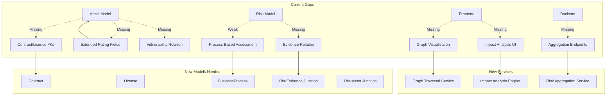
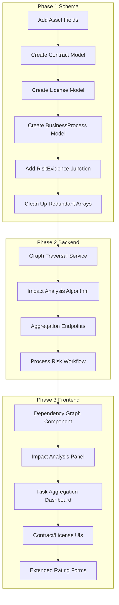

# ISO 27001 Gap Analysis - Asset Management System

**Date:** 2026-07-16
**Analyzer:** Technical Architecture Review
**Scope:** IT-Asset-Management (Section 6) + Risk Management (Section 8)

> **Status update (verified against the current codebase):** This document is a historical gap analysis. Most gaps listed below have since been implemented: the `Contract`, `License`, and `BusinessProcess` Prisma models; junction tables (`AssetContract`, `AssetLicense`, `AssetProcess`, `AssetService`, `RiskAsset`, `RiskProcess`, `IncidentAsset`, `VulnerabilityAsset`); the AST-004 extended rating fields on `Asset`; the `BACKED_UP_BY` relationship type in [`shared/src/types/asset.ts`](shared/src/types/asset.ts); risk aggregation endpoints in [`backend/src/routes/risk.routes.ts`](backend/src/routes/risk.routes.ts) with [`backend/src/services/risk.aggregation.ts`](backend/src/services/risk.aggregation.ts); and the corresponding frontend pages (`Contracts.tsx`, `Licenses.tsx`, `Processes.tsx`, `RiskAggregation.tsx`). Status markers below have been updated accordingly; the original recommendations are kept for context.

---

## Executive Summary

The current codebase has a **strong foundational structure** for ISO 27001 compliance. The Prisma schema covers most core entities, and the shared TypeScript types align well with requirements. At the time of this analysis, gaps existed in:

1. **Asset fields** - contract/license info, additional rating dimensions, linked risks/vulnerabilities/incidents as proper relations → since implemented (junction tables + AST-004 fields in [`backend/prisma/schema.prisma`](backend/prisma/schema.prisma))
2. **Risk model** - process-based assessment support and aggregated view endpoints → since implemented (`BusinessProcess`/`RiskScenario` models, `/api/v1/risks/aggregated/*` endpoints); evidence linking is handled via the generic `EvidenceLink` model
3. **Graph visualization** (AST-011) and **impact analysis** (AST-012) - completed

4. **Frontend components** for dependency graph, impact analysis, and risk aggregation views → since implemented (`AssetGraph.tsx`, `AssetImpactAnalysis.tsx`, `RiskAggregation.tsx`)

---

## 1. IT-Asset-Management (Section 6)

### 6.1 Asset Types

| Requirement | Required Type | Current Status | Gap |
|---|---|---|---|
| Physical servers/clients | `physical_server`, `client` | ✅ Exists in [`AssetType`](shared/src/types/asset.ts:6-7) enum | None |
| VMs/containers | `virtual_machine`, `container` | ✅ Exists [`AssetType.VIRTUAL_MACHINE`](shared/src/types/asset.ts:8), [`AssetType.CONTAINER`](shared/src/types/asset.ts:9) | None |
| Network/security components | `network_component`, `security_component` | ✅ Exists [`AssetType.NETWORK_COMPONENT`](shared/src/types/asset.ts:10), [`AssetType.SECURITY_COMPONENT`](shared/src/types/asset.ts:11) | None |
| Mobile devices | `mobile_device` | ✅ Exists [`AssetType.MOBILE_DEVICE`](shared/src/types/asset.ts:12) | None |
| OT systems | `ot_system` | ✅ Exists [`AssetType.OT_SYSTEM`](shared/src/types/asset.ts:13) | None |
| Applications/software | `application`, `software_product` | ✅ Exists [`AssetType.APPLICATION`](shared/src/types/asset.ts:14), [`AssetType.SOFTWARE_PRODUCT`](shared/src/types/asset.ts:15) | None |
| OS/installed software | `operating_system` | ✅ Exists [`AssetType.OPERATING_SYSTEM`](shared/src/types/asset.ts:16) | None |
| Cloud resources | `cloud_resource` | ✅ Exists [`AssetType.CLOUD_RESOURCE`](shared/src/types/asset.ts:17) | None |
| SaaS services | `saas_service` | ✅ Exists [`AssetType.SAAS_SERVICE`](shared/src/types/asset.ts:18) | None |
| Databases | `database` | ✅ Exists [`AssetType.DATABASE`](shared/src/types/asset.ts:19) | None |
| Data sets | `data_asset` | ✅ Exists [`AssetType.DATA_ASSET`](shared/src/types/asset.ts:20) | None |
| User accounts/technical accounts/privileged identities | `user_account`, `technical_account`, `privileged_identity` | ✅ Exists [`AssetType.USER_ACCOUNT`](shared/src/types/asset.ts:21-23) | None |
| Certificates/crypto keys | `certificate`, `cryptographic_key` | ✅ Exists [`AssetType.CERTIFICATE`](shared/src/types/asset.ts:24), [`AssetType.CRYPTOGRAPHIC_KEY`](shared/src/types/asset.ts:25) | None |
| Business processes | `business_process` | ✅ Exists [`AssetType.BUSINESS_PROCESS`](shared/src/types/asset.ts:26) | None |
| IT/enterprise services | `it_service`, `enterprise_service` | ✅ Exists [`AssetType.IT_SERVICE`](shared/src/types/asset.ts:27), [`AssetType.ENTERPRISE_SERVICE`](shared/src/types/asset.ts:28) | None |
| Buildings/rooms/facilities | `building`, `room` | ✅ Exists [`AssetType.BUILDING`](shared/src/types/asset.ts:29), [`AssetType.ROOM`](shared/src/types/asset.ts:30) | None |
| Suppliers/external services | `supplier`, `external_service` | ✅ Exists [`AssetType.SUPPLIER`](shared/src/types/asset.ts:31), [`AssetType.EXTERNAL_SERVICE`](shared/src/types/asset.ts:32) | None |
| Contracts/licenses | `contract`, `license` | ✅ Exists [`AssetType.CONTRACT`](shared/src/types/asset.ts:33), [`AssetType.LICENSE`](shared/src/types/asset.ts:34) | None |

**Verdict:** ✅ **FULLY COVERED** - All 18+ asset types defined in enum and supported by configurable `AssetType` model.

---

### AST-002 Asset Fields

| Required Field | Schema Field | Type | Status | Notes |
|---|---|---|---|---|
| Unique immutable ID | [`id`](backend/prisma/schema.prisma:238) | `String @id @default(uuid())` | ✅ | UUID-based, immutable |
| Display ID | [`displayId`](backend/prisma/schema.prisma:239) | `String @unique` | ✅ | Human-readable identifier |
| Name | [`name`](backend/prisma/schema.prisma:240) | `String` | ✅ | |
| Description | [`description`](backend/prisma/schema.prisma:241) | `String?` | ✅ | |
| Type/Subtype | [`assetTypeId`](backend/prisma/schema.prisma:242), [`subType`](backend/prisma/schema.prisma:243) | `String`, `String?` | ✅ | FK to AssetType + free-text subtype |
| Manufacturer/Model | [`manufacturer`](backend/prisma/schema.prisma:244), [`model`](backend/prisma/schema.prisma:245) | `String?` | ✅ | |
| Serial Number | [`serialNumber`](backend/prisma/schema.prisma:246) | `String?` | ✅ | |
| External ID | [`externalId`](backend/prisma/schema.prisma:247) | `String?` | ✅ | |
| Company/Location/Org Unit | [`organizationUnitId`](backend/prisma/schema.prisma:248), [`locationId`](backend/prisma/schema.prisma:249) | `String?` | ✅ | FK to OrganizationUnit + Site |
| Technical Operator | [`technicalOperatorId`](backend/prisma/schema.prisma:250) | `String?` | ✅ | User reference |
| Business Owner | [`businessOwnerId`](backend/prisma/schema.prisma:251) | `String?` | ✅ | User reference |
| IS Security Responsible | [`informationSecurityResponsibleId`](backend/prisma/schema.prisma:252) | `String?` | ✅ | User reference |
| Related Business Process | [`AssetProcess`](backend/prisma/schema.prisma:3368) junction table | Relation | ✅ | M:N via junction table (replaces single FK) |
| Related Service | [`AssetService`](backend/prisma/schema.prisma:3381) junction table | Relation | ✅ | M:N via junction table (replaces single FK) |
| Lifecycle Status | [`lifecycleStatus`](backend/prisma/schema.prisma:255) | `String` | ✅ | Enum in shared types covers 11 states |
| Procurement Date | [`purchaseDate`](backend/prisma/schema.prisma:256) | `DateTime?` | ✅ | |
| Commissioning Date | [`commissioningDate`](backend/prisma/schema.prisma:257) | `DateTime?` | ✅ | |
| Contract/License Info | [`AssetContract`](backend/prisma/schema.prisma:3394) / [`AssetLicense`](backend/prisma/schema.prisma:3407) junction tables + `licenseInfo`/`contractEndsAt`/`licenseExpiresAt` fields | Relation | ✅ | Implemented as M:N junction tables instead of single FKs |
| EOS/EOL/EOS Dates | [`endOfSaleDate`](backend/prisma/schema.prisma:258), [`endOfLifeDate`](backend/prisma/schema.prisma:259), [`endOfSupportDate`](backend/prisma/schema.prisma:260) | `DateTime?` | ✅ | All three covered |
| CIA Ratings | [`confidentialityNeed`](backend/prisma/schema.prisma:261), [`integrityNeed`](backend/prisma/schema.prisma:262), [`availabilityNeed`](backend/prisma/schema.prisma:263) | `String` | ✅ | Low/Medium/High |
| Data Protection Relevance | [`dataProtectionRelevance`](backend/prisma/schema.prisma:264) | `Boolean` | ✅ | |
| Criticality | [`criticality`](backend/prisma/schema.prisma:265) | `String` | ✅ | Low/Medium/High/Critical |
| Network Addresses | [`NetworkAddress`](backend/prisma/schema.prisma:748) model | Relation | ✅ | Normalized model replaced the `String[]` array |
| DNS Names | - | - | ⚠️ | DNS names are stored via the `NetworkAddress` model; no separate `dnsNames` field remains on Asset |
| Data Source | [`dataSource`](backend/prisma/schema.prisma:268) | `String?` | ✅ | |
| Detection Time | [`lastDetectedAt`](backend/prisma/schema.prisma:269) | `DateTime?` | ✅ | |
| Assigned Risks | [`RiskAsset`](backend/prisma/schema.prisma:3329) junction table | Relation | ✅ | Proper many-to-many; the denormalized `affectedAssetIds` array was removed |
| Assigned Controls | [`controls`](backend/prisma/schema.prisma:286) | Relation | ✅ | Proper relation to Control |
| Vulnerabilities | [`VulnerabilityAsset`](backend/prisma/schema.prisma:3342) junction table | Relation | ✅ | Implemented as many-to-many junction table |
| Incidents | [`IncidentAsset`](backend/prisma/schema.prisma:3355) junction table | Relation | ✅ | Implemented; Incident's `affectedAssetIds` array was removed |
| Documents/Evidence | [`AssetDocument`](backend/prisma/schema.prisma:3316) + generic [`EvidenceLink`](backend/prisma/schema.prisma:2034) (`entityType`/`entityId`) | Relation | ✅ | Implemented via document junction and the entity-type-generic evidence link mechanism |

**Verdict:** ✅ **COVERED** - The previously missing contract/license, vulnerability, incident, and evidence relations are now modeled as proper junction tables; business process/service links use M:N junction tables.

---

### AST-003 Configurable CIA Dimensions

| Requirement | Current Status | Gap |
|---|---|---|
| Configurable confidentiality dimension | ✅ [`confidentialityNeed`](backend/prisma/schema.prisma:261) with low/medium/high | None for basic support. For full configurability, see RiskMethod model which stores scales as JSON. |
| Configurable integrity dimension | ✅ [`integrityNeed`](backend/prisma/schema.prisma:262) | Same as above |
| Configurable availability dimension | ✅ [`availabilityNeed`](backend/prisma/schema.prisma:263) | Same as above |

**Verdict:** ✅ **COVERED** - CIA ratings exist. The [`RiskMethod`](backend/prisma/schema.prisma:306) model stores `likelihoodScale` and `impactScale` as JSON, allowing configurable rating scales per method.

---

### AST-004 Additional Rating Dimensions

| Required Dimension | Current Status | Gap |
|---|---|---|
| Personnel safety relevance | ✅ [`personnelSafetyRelevance`](backend/prisma/schema.prisma:653) | Field exists with low/medium/high |
| Regulatory compliance relevance | ✅ [`regulatoryRelevance`](backend/prisma/schema.prisma:654) | Field exists in addition to `dataProtectionRelevance` |
| Financial damage potential | ✅ [`financialDamagePotential`](backend/prisma/schema.prisma:655) | Field exists |
| Production downtime impact | ✅ [`productionDowntimeImpact`](backend/prisma/schema.prisma:656) | Field exists |

**Verdict:** ✅ **COVERED** - All 4 extended rating dimensions exist on the Asset model and are editable in [`frontend/src/pages/Assets.tsx`](frontend/src/pages/Assets.tsx).

---

### AST-010 Directed Asset Relationships

| Required Relationship Type | Current Enum Value | Status |
|---|---|---|
| "runs on" | [`OPERATES_ON`](shared/src/types/asset.ts:52) | ✅ |
| "communicates with" | [`COMMUNICATES_WITH`](shared/src/types/asset.ts:53) | ✅ |
| "uses" | [`USES`](shared/src/types/asset.ts:54) | ✅ |
| "contains" | [`CONTAINS`](shared/src/types/asset.ts:55) | ✅ |
| "is backed up by" | [`BACKED_UP_BY`](shared/src/types/asset.ts:63) | ✅ |
| "is part of" | [`IS_PART_OF`](shared/src/types/asset.ts:57) | ✅ |
| "processes information" | [`PROCESSES_INFORMATION`](shared/src/types/asset.ts:58) | ✅ |
| "supports business process" | [`SUPPORTS_BUSINESS_PROCESS`](shared/src/types/asset.ts:59) | ✅ |
| "provided by supplier" | [`PROVIDED_BY_SUPPLIER`](shared/src/types/asset.ts:60) | ✅ |
| "depends on service" | [`DEPENDS_ON_SERVICE`](shared/src/types/asset.ts:61) | ✅ |
| "has admin access to" | [`HAS_ADMIN_ACCESS_TO`](shared/src/types/asset.ts:62) | ✅ |

**Schema Model:** [`AssetRelation`](backend/prisma/schema.prisma:291-304) exists with `sourceAssetId`, `targetAssetId`, `relationshipType`, and `description`.

**Verdict:** ✅ **COVERED** - All listed relationship types, including `BACKED_UP_BY`, are present in the enum.

---

### AST-011 Graph Visualization of Dependencies

| Requirement | Current Status | Gap |
|---|---|---|
| Visual graph of asset dependencies | ✅ **IMPLEMENTED** | None |

**Verdict:** ✅ **COVERED** - Implementation complete (Asset Tree Viewer).

---

### AST-012 Impact Analysis Along Dependencies

| Requirement | Current Status | Gap |
|---|---|---|
| Calculate blast radius of asset failure | ✅ **IMPLEMENTED** | None |
| Traverse dependency graph for cascading effects | ✅ **IMPLEMENTED** | None |
| Identify critical paths and single points of failure | ✅ **IMPLEMENTED** | None |

**Verdict:** ✅ **COVERED** - Implementation complete (includes BFS traversal, criticality weighting, and articulation point identification).


---

## 2. Risk Management (Section 8)

### Risk Model Field Analysis

| Required Field | Schema Field | Type | Status | Notes |
|---|---|---|---|---|
| Unique ID | [`id`](backend/prisma/schema.prisma:331) | `String @id` | ✅ | UUID-based |
| Display ID | [`displayId`](backend/prisma/schema.prisma:332) | `String @unique` | ✅ | Human-readable (RSK-XXXX format) |
| Title | [`title`](backend/prisma/schema.prisma:333) | `String` | ✅ | |
| Description | [`description`](backend/prisma/schema.prisma:334) | `String` | ✅ | |
| Affected org unit | [`organizationUnitId`](backend/prisma/schema.prisma:335) | `String?` | ✅ | FK to OrganizationUnit |
| Affected assets | [`RiskAsset`](backend/prisma/schema.prisma:3329) junction table + `assets` relation | Relation | ✅ | The redundant `affectedAssetIds` array was removed; proper many-to-many only |
| Affected processes | [`RiskProcess`](backend/prisma/schema.prisma:3433) junction table | Relation | ✅ | Array replaced by junction table |
| Affected services | [`RiskService`](backend/prisma/schema.prisma) junction table (`serviceLinks`) | Relation | ✅ | Array replaced by junction table |
| Threat | [`threat`](backend/prisma/schema.prisma:1006) relation to `Threat` model | Relation | ✅ | Proper Prisma relation defined (legacy FK kept as `threatId`) |
| Vulnerability/Cause | [`vulnerability`](backend/prisma/schema.prisma:1007) relation to `Vulnerability` model + `causes` (`RiskCauseLink`) | Relation | ✅ | Proper Prisma relations defined |
| Potential impact | [`possibleImpact`](backend/prisma/schema.prisma:341) | `String` | ✅ | Free-text description |
| Existing controls | [`riskControls`](backend/prisma/schema.prisma:995) (`RiskControl` junction) | Relation | ✅ | Redundant array removed; junction table only |
| Probability | [`likelihood`](backend/prisma/schema.prisma:343) | `Int` | ✅ | Numeric scale |
| Severity | [`impact`](backend/prisma/schema.prisma:344) | `Int` | ✅ | Numeric scale |
| Inherent risk | [`inherentRisk`](backend/prisma/schema.prisma:345) | `String` | ✅ | Calculated field |
| Residual risk | [`residualRisk`](backend/prisma/schema.prisma:346) | `String` | ✅ | Post-control risk level |
| Target risk | [`targetRisk`](backend/prisma/schema.prisma:347) | `String` | ✅ | Desired risk level after treatment |
| Risk owner | [`riskOwnerId`](backend/prisma/schema.prisma:348) | `String` | ✅ | User reference |
| Assessor | [`assessorId`](backend/prisma/schema.prisma:349) | `String` | ✅ | User reference |
| Assessment date | [`assessmentDate`](backend/prisma/schema.prisma:350) | `DateTime` | ✅ | |
| Next review date | [`nextReviewDate`](backend/prisma/schema.prisma:351) | `DateTime` | ✅ | |
| Justification | [`evaluationJustification`](backend/prisma/schema.prisma:352) | `String?` | ✅ | |
| Linked evidence | Generic [`EvidenceLink`](backend/prisma/schema.prisma:2034) (`entityType`/`entityId`) | Relation | ✅ | Implemented via the entity-type-generic evidence link mechanism rather than a Risk-specific junction |
| Status | [`status`](backend/prisma/schema.prisma:353) | `String` | ✅ | Enum in shared types covers 6 states |

**Verdict:** ✅ **COVERED** - All listed fields are modeled; the redundant array+relation dual storage was cleaned up in favor of junction tables.

---

### RSK-010 Asset-based AND Process/Scenario-based Risk Assessment

| Requirement | Current Status | Gap |
|---|---|---|
| Asset-based risk assessment | ✅ Supported via `affectedAssetIds` and Asset→Risk relation | The current model supports linking risks to assets |
| Process/scenario-based risk assessment | ✅ **IMPLEMENTED** | [`BusinessProcess`](backend/prisma/schema.prisma:3285) model with `/api/v1/processes` routes ([`businessprocess.routes.ts`](backend/src/routes/businessprocess.routes.ts)); risks link to processes via the `RiskProcess` junction table and a direct `businessProcessId` relation. A [`RiskScenario`](backend/prisma/schema.prisma:1266) model supports scenario-based assessment (threat + vulnerability context). |

**Gap Analysis (original, resolved):**
- ~~No `BusinessProcess` model in schema~~ → now present with CRUD routes and service ([`businessprocess.service.ts`](backend/src/services/businessprocess.service.ts))
- ~~Process-based risks use free-text IDs~~ → replaced by the `RiskProcess` junction table
- ~~No scenario-based assessment workflow~~ → `RiskScenario` + `RiskCauseLink`/`RiskImpactLink` models exist and are referenced from Risk via `scenarioId`

**Verdict:** ✅ **COVERED** - Asset-based and process/scenario-based assessment are both supported.

---

### RSK-011 Aggregated Views by Location, Company, Process, Asset Type, Scope

| Required View | Current Status | Gap |
|---|---|---|
| Risks by location | ✅ **IMPLEMENTED** | `GET /api/v1/risks/aggregated/by-location` ([`risk.routes.ts`](backend/src/routes/risk.routes.ts:144), [`risk.aggregation.ts`](backend/src/services/risk.aggregation.ts)) |
| Risks by company/org unit | ✅ **IMPLEMENTED** | `GET /api/v1/risks/aggregated/by-org-unit` |
| Risks by process | ✅ **IMPLEMENTED** | `GET /api/v1/risks/aggregated/by-process` |
| Risks by asset type | ✅ **IMPLEMENTED** | `GET /api/v1/risks/aggregated/by-asset-type` |
| Risks by ISMS scope | ✅ **IMPLEMENTED** | `GET /api/v1/risks/aggregated/by-scope`; additional dimensions exist (`by-service`, `by-risk-class`, `by-status`) |

**Verdict:** ✅ **COVERED** - Aggregation endpoints for all requested dimensions exist (admin-protected), with a frontend dashboard in [`frontend/src/pages/RiskAggregation.tsx`](frontend/src/pages/RiskAggregation.tsx).

---

## 3. Recommended Schema Changes

> **Status:** The schema changes recommended in this section have largely been implemented, as noted per item below. Implementation deviated in places (junction tables instead of single FKs/arrays; generic `EvidenceLink` instead of a Risk-specific junction).

### 3.1 Asset Model Additions

```prisma
// Add to existing Asset model:

// Additional rating dimensions (AST-004)
personnelSafetyRelevance   String    @default("low")     // low, medium, high
regulatoryRelevance        String    @default("low")     // low, medium, high  
financialDamagePotential   String    @default("low")     // low, medium, high
productionDowntimeImpact   String    @default("low")     // low, medium, high

// Contract/License info (AST-002 gap)
contractId                 String?                     // FK to new Contract model
licenseId                  String?                     // FK to new License model

// Multiple business processes and services (AST-002 improvement)
businessProcessIds         String[]  @default([])      // Replace single businessProcessId
serviceIds                 String[]  @default([])       // Replace single serviceId

// Relations for vulnerabilities, incidents, evidence (AST-002 gap)
// These will be many-to-many via the existing models' array fields
```

### 3.2 New Models Required

#### Contract Model
```prisma
model Contract {
  id              String   @id @default(uuid())
  displayId       String   @unique
  title           String
  description     String?
  contractType    String                // purchase, maintenance, sla, support, etc.
  supplierId      String?               // FK to Supplier
  startDate       DateTime?
  endDate         DateTime?
  renewalDate     DateTime?
  value           Decimal?
  currency        String?
  status          String   @default("active")
  isArchived      Boolean  @default(false)
  createdAt       DateTime @default(now())
  updatedAt       DateTime @updatedAt
  createdBy       String?
  updatedBy       String?

  assets          Asset[]    @relation("AssetContract")
  
  @@map("contracts")
}
```

#### License Model
```prisma
model License {
  id              String   @id @default(uuid())
  displayId       String   @unique
  title           String
  description     String?
  licenseType     String                // perpetual, subscription, concurrent, etc.
  vendor          String?
  productId       String?               // Reference to software asset
  licenseKey      String?
  seats           Int?
  startDate       DateTime?
  endDate         DateTime?
  renewalDate     DateTime?
  cost            Decimal?
  currency        String?
  status          String   @default("active")
  isArchived      Boolean  @default(false)
  createdAt       DateTime @default(now())
  updatedAt       DateTime @updatedAt
  createdBy       String?
  updatedBy       String?

  assets          Asset[]    @relation("AssetLicense")
  
  @@map("licenses")
}
```

#### BusinessProcess Model (for RSK-010)
```prisma
model BusinessProcess {
  id              String   @id @default(uuid())
  displayId       String   @unique
  name            String
  description     String?
  processOwner    String                // User ID
  category        String?               // core, supporting, management
  siacControlled  Boolean  @default(false)
  criticality     String   @default("low")
  status          String   @default("active")
  isArchived      Boolean  @default(false)
  createdAt       DateTime @default(now())
  updatedAt       DateTime @updatedAt
  createdBy       String?
  updatedBy       String?

  risks           Risk[]   @relation("ProcessRisks")
  
  @@map("business_processes")
}
```

#### Risk-Evidence Many-to-Many (for linked evidence)
```prisma
// Add to existing Evidence model:
risks              RiskEvidence[]

// New junction table:
model RiskEvidence {
  id        String @id @default(uuid())
  riskId    String
  evidenceId String
  
  risk      Risk     @relation(fields: [riskId], references: [id])
  evidence  Evidence @relation(fields: [evidenceId], references: [id])
  
  @@unique([riskId, evidenceId])
  @@map("risk_evidence")
}

// Add to existing Risk model:
evidenceLinks    RiskEvidence[]
```

### 3.3 Schema Improvements for Existing Models

#### AssetRelation - Add missing relationship type
✅ **DONE** — `BACKED_UP_BY = 'backed_up_by'` exists in the [`AssetRelationshipType`](shared/src/types/asset.ts:63) enum.

#### Risk Model - Clean up redundant storage
✅ **DONE** (implemented differently than sketched):
- ~~Remove `affectedAssetIds` array~~ — removed; the `RiskAsset` junction table is used instead
- ~~Add proper relations for Threat and Vulnerability~~ — real Prisma relations now exist on `Risk` (`threat`, `vulnerability`)
- ~~Add `evidenceLinks` relation to Evidence~~ — evidence linking is handled by the generic [`EvidenceLink`](backend/prisma/schema.prisma:2034) model (`entityType`/`entityId`), not a dedicated `RiskEvidence` junction table

```prisma
// New junction table for Risk-Assets (replaces affectedAssetIds array):
model RiskAsset {
  id        String @id @default(uuid())
  riskId    String
  assetId   String
  
  risk      Risk   @relation(fields: [riskId], references: [id])
  asset     Asset  @relation(fields: [assetId], references: [id])
  
  @@unique([riskId, assetId])
  @@map("risk_assets")
}

// Add to Risk model:
threat           Threat?      @relation("RiskThreats", fields: [threatId], references: [id])
vulnerability    Vulnerability? @relation("RiskVulnerabilities", fields: [vulnerabilityId], references: [id])
riskAssets       RiskAsset[]  
```

---

## 4. New API Endpoints Required

> **Status:** All endpoints listed in this section are implemented and registered in [`backend/src/index.ts`](backend/src/index.ts).

### Asset Management APIs

| Endpoint | Method | Purpose | Requirement |
|---|---|---|---|
| `/api/v1/assets/:id/graph` | GET | Return adjacency list for graph visualization | AST-011 — ✅ implemented ([`asset.routes.ts`](backend/src/routes/asset.routes.ts:259)) |
| `/api/v1/assets/:id/impact-analysis` | GET | Calculate blast radius along dependencies | AST-012 — ✅ implemented ([`asset.routes.ts`](backend/src/routes/asset.routes.ts:275); GET, not POST) |
| `/api/v1/assets/:id/dependencies` | GET | List all upstream/downstream dependencies | AST-011, AST-012 — ✅ implemented (plus `/:id/upstream`, `/:id/downstream`) |
| `/api/v1/contracts` | CRUD | Contract management | AST-002 — ✅ implemented ([`contract.routes.ts`](backend/src/routes/contract.routes.ts)) |
| `/api/v1/licenses` | CRUD | License management | AST-002 — ✅ implemented ([`license.routes.ts`](backend/src/routes/license.routes.ts)) |

### Risk Management APIs

| Endpoint | Method | Purpose | Requirement |
|---|---|---|---|
| `/api/v1/risks/aggregated/by-location` | GET | Risks grouped by site/location | RSK-011 — ✅ implemented |
| `/api/v1/risks/aggregated/by-org-unit` | GET | Risks grouped by organization unit | RSK-011 — ✅ implemented |
| `/api/v1/risks/aggregated/by-process` | GET | Risks grouped by business process | RSK-011 — ✅ implemented |
| `/api/v1/risks/aggregated/by-asset-type` | GET | Risks grouped by asset type | RSK-011 — ✅ implemented |
| `/api/v1/risks/aggregated/by-scope` | GET | Risks within ISMS scope | RSK-011 — ✅ implemented (plus `by-service`, `by-risk-class`, `by-status`) |
| `/api/v1/processes` | CRUD | Business process management | RSK-010 — ✅ implemented ([`businessprocess.routes.ts`](backend/src/routes/businessprocess.routes.ts)) |

---

## 5. Frontend Components Needed

> **Status (verified against `frontend/src/pages` and `frontend/src/components`):** Status markers below reflect the current codebase.

### Asset Management UI

| Component | Purpose | Requirement | Status |
|---|---|---|---|
| `AssetDependencyGraph` | Interactive graph visualization of asset relationships using React Flow or similar | AST-011 | ✅ Implemented |
| `AssetImpactAnalysis` | What-if scenario analysis panel showing cascading effects | AST-012 | ✅ Implemented |
| `ContractManagement` | CRUD interface for contracts linked to assets | AST-002 | ✅ Implemented ([`Contracts.tsx`](frontend/src/pages/Contracts.tsx)) |
| `LicenseManagement` | CRUD interface for licenses linked to assets | AST-002 | ✅ Implemented ([`Licenses.tsx`](frontend/src/pages/Licenses.tsx)) |
| `AssetExtendedRatings` | Form section for additional rating dimensions (personnel safety, regulatory, financial, downtime) | AST-004 | ✅ Implemented in [`Assets.tsx`](frontend/src/pages/Assets.tsx) |

### Risk Management UI

| Component | Purpose | Requirement | Status |
|---|---|---|---|
| `RiskAggregationDashboard` | Dashboard with aggregated risk views by location, org unit, process, asset type, scope | RSK-011 | ✅ Implemented ([`RiskAggregation.tsx`](frontend/src/pages/RiskAggregation.tsx)) |
| `ProcessBasedRiskAssessment` | Workflow for creating process/scenario-based risks without asset linkage | RSK-010 | ⚠️ Partial — process selection exists in the risk form ([`Risks.tsx`](frontend/src/pages/Risks.tsx)); no dedicated scenario workflow UI |
| `BusinessProcessRegistry` | CRUD interface for business processes | RSK-010 | ✅ Implemented ([`Processes.tsx`](frontend/src/pages/Processes.tsx)) |
| `RiskEvidenceLinker` | UI to link evidence items to risk records | Risk Model Gap | ❌ Not implemented (the evidence tab in [`RiskDetail.tsx`](frontend/src/pages/RiskDetail.tsx) is a placeholder; backend linking via `EvidenceLink` exists) |

---

## 6. Summary of Gaps by Priority

> **Status:** Resolved/closed markers reflect the current codebase (verified against `backend/prisma/schema.prisma`, backend routes/services, and frontend pages).

### Critical Gaps (Block ISO 27001 Compliance)

| # | Gap | Requirement | Status |
|---|---|---|---|
| 1 | No graph visualization for asset dependencies | AST-011 | ✅ Closed ([`AssetGraph.tsx`](frontend/src/components/AssetGraph.tsx), `/graph` endpoints) |
| 2 | No impact analysis along dependency chains | AST-012 | ✅ Closed ([`AssetImpactAnalysis.tsx`](frontend/src/components/AssetImpactAnalysis.tsx), `impact-analysis` endpoint) |
| 3 | No process/scenario-based risk assessment workflow | RSK-010 | ✅ Mostly closed (models + API done; dedicated scenario UI still open) |
| 4 | No aggregated risk views by dimension | RSK-011 | ✅ Closed (aggregation endpoints + `RiskAggregation.tsx`) |

### Important Gaps (Data Model Completeness)

| # | Gap | Requirement | Status |
|---|---|---|---|
| 5 | Missing contract/license fields and models on Asset | AST-002 | ✅ Closed (`Contract`/`License` models + junction tables) |
| 6 | Missing additional rating dimensions on Asset | AST-004 | ✅ Closed (fields present in schema, shared types, and UI) |
| 7 | Missing evidence linkage from Risk model | Risk Model | ✅ Closed via generic `EvidenceLink`; frontend linker UI still open |
| 8 | Missing `BACKED_UP_BY` relationship type | AST-010 | ✅ Closed (enum value present) |
| 9 | Redundant storage patterns (arrays + relations) | Data Quality | ✅ Closed (arrays removed in favor of junction tables) |

### Enhancement Opportunities

| # | Gap | Requirement | Status |
|---|---|---|---|
| 10 | Single FK for business process/service - should support multiple | AST-002 | ✅ Closed (`AssetProcess`/`AssetService` junction tables) |
| 11 | Threat/Vulnerability FKs without Prisma relations | Data Quality | ✅ Closed (real relations on `Risk`) |
| 12 | No BusinessProcess model in schema | RSK-010 | ✅ Closed (`BusinessProcess` model + routes/service/UI) |

---

## 7. Implementation Roadmap

> **Status:** Phases 1–2 are complete (schema foundation and backend services, as verified per item in Sections 3–5 above). Phase 3 is largely complete; the only open frontend item is a dedicated evidence-linking / scenario workflow UI. Phase 4 items are tracked in `docs/e2e-testing.md` and the test suites rather than in this document.

### Phase 1: Schema Foundation (Data Model)
1. Add missing fields to Asset model (AST-004 dimensions, contract/license FKs)
2. Create Contract and License models
3. Create BusinessProcess model
4. Add Risk-Evidence junction table
5. Clean up redundant array storage in Risk model
6. Add `BACKED_UP_BY` relationship type enum

### Phase 2: Backend Services
1. Implement graph traversal service for AST-011/AST-012
2. Implement impact analysis algorithm (BFS/DFS with criticality weighting)
3. Create aggregation endpoints for RSK-011
4. Add process-based risk assessment workflow

### Phase 3: Frontend Implementation
1. Build `AssetDependencyGraph` component with React Flow
2. Build `AssetImpactAnalysis` panel
3. Build `RiskAggregationDashboard` 
4. Build contract/license management UIs
5. Extend asset form with additional rating dimensions
6. Build business process registry

### Phase 4: Integration and Testing
1. End-to-end testing of impact analysis scenarios
2. Performance testing for graph traversal on large datasets
3. Data migration for existing assets (new fields)
4. User acceptance testing

---

## 8. Mermaid: Current vs Target Architecture





---

**Document End**
*This historical gap analysis identified a set of specific gaps across the ISO 27001 requirements. As of the status update above, nearly all of them have been closed in the current codebase; the remaining open items are frontend workflow conveniences (dedicated risk-evidence linker and scenario-assessment UI), not data-model or API gaps.*
