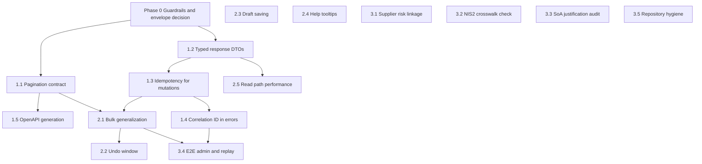

# Improvement Roadmap P1 → P3

> **Decision log (locked 2026-10-30).** The four open decisions are now fixed; phases below are binding and do not re-open them.

**Scope:** API contract consistency, write-path repeat safety, observability, operability, read-path performance, accessibility, governance, repository hygiene.

**Method:** Every claim below was verified against the current code, not against the historical audits. Line references point at the decisive location.

---

## 0. Baseline correction (what is already done vs. still open)

| Claim from older audits | Verified current state |
|---|---|
| ETag not wired | **Done** — `etag()` mounted on assets/risks/controls/incidents/tickets/search ([`index.ts`](backend/src/index.ts:229)) |
| Rate limiting missing | **Done** — auth limiter + API limiter ([`index.ts`](backend/src/index.ts:150)) |
| CORS missing / compression missing | **Done** — allowlist CORS and `compression()` ([`index.ts`](backend/src/index.ts:182)) |
| Unified error envelope missing | **Done** — `{ success, error: { message, code, details } }` parsed by [`apiError.ts`](frontend/src/utils/apiError.ts:22) |
| Toasts / skeletons missing | **Done** — [`ToastProvider.tsx`](frontend/src/components/ToastProvider.tsx:90), skeleton usage |
| Correlation ID missing | **Done** — header set ([`correlationId.ts`](backend/src/middleware/correlationId.ts:16)) but **never consumed by the frontend** |
| Pagination middleware wiring | **Obsolete claim** — `backend/src/middleware/pagination.ts` no longer exists in the middleware directory; list routes return `{ data, pagination }` only |
| Keyboard shortcuts / Cmd+K missing | **Done** — [`useKeyboardShortcuts.ts`](frontend/src/hooks/useKeyboardShortcuts.ts), [`CommandPalette.tsx`](frontend/src/components/CommandPalette.tsx) |
| Bulk operations missing | **Partially done** — only Assets bulk archive ([`asset.routes.ts`](backend/src/routes/asset.routes.ts:95)); `bulk.*` i18n keys already exist ([`localeKeys.test.ts`](frontend/src/locales/localeKeys.test.ts:120)) |
| Idempotency-Key sent by frontend | **Open** — 0 occurrences of `Idempotency` in `frontend/src` |

**Two structural findings worth calling out early:**

1. `X-Total-Count` is set on sub-resource routes only ([`asset.routes.ts`](backend/src/routes/asset.routes.ts:238), [`risk.routes.ts`](backend/src/routes/risk.routes.ts:268)), never on the primary list routes ([`asset.routes.ts`](backend/src/routes/asset.routes.ts:20)).
2. Documentation drift: [`plans/backend-api-ux-analysis.md`](plans/backend-api-ux-analysis.md:10) still references a pagination middleware that has been deleted. Phase 1 must correct the docs, not resurrect the file.

---

## Phase 0 — Guardrails (prerequisite for all phases)

- Establish a green baseline before touching contracts: `npm run build --workspace shared`, then `backend`, then `frontend`.
- Record the current contract shape with characterization tests so Phase 1 changes are provable, not speculative.
- Envelope decision already locked as D1 (see Decision log): keep `{ data, pagination }`, add `X-Total-Count` additively, no `meta`. Phase 0 only records the baseline, it does not re-open the decision.

**Exit criteria:** build + backend/frontend test suites green; envelope decision documented.

### Phase 0 Baseline (recorded 2026-10-30)

Gate status at the start of Phase 1, before any contract change:

| Gate | Command | Status | Result |
|---|---|---|---|
| `shared` build | `npm run build --workspace shared` | **PASSED** | `tsc` exit 0 |
| `backend` build | `npm run build --workspace backend` | **PASSED** | `tsc` exit 0 |
| `frontend` build | `npm run build --workspace frontend` | **PASSED** | `tsc && vite build`, 1452 modules, built in ~22 s |
| backend tests | `DATABASE_URL=... npm test --workspace backend -- --runInBand --ci` | **PASSED** | 81 suites passed, 3 skipped; 1156 tests passed, 6 skipped (1162 total, 84 suites). `DATABASE_URL` was available from `backend/.env` (PostgreSQL at 192.168.66.222). |
| frontend tests | `npm test --workspace frontend -- --run` | **PASSED** | 22 test files passed, 244 tests passed |

No gate was failing at baseline, so Phase 1.1 starts from a green tree.

After Phase 1.1 changes (re-verified):

| Gate | Status | Result |
|---|---|---|
| `shared` build | **PASSED** | exit 0 |
| `backend` build | **PASSED** | exit 0 (includes new `utils/pagination.ts`) |
| `frontend` build | **PASSED** | exit 0 |
| targeted backend tests (`list.pagination.headers`, `subresource.pagination`, `core.dto-serialization`) | **PASSED** | 3 suites, 29 tests passed — the pre-existing envelope assertion in [`core.dto-serialization.test.ts`](backend/src/__tests__/core.dto-serialization.test.ts:239) still holds |

Full-suite re-verification after Phase 1.1:

| Gate | Status | Result |
|---|---|---|
| backend tests (full) | **PASSED** | 82 suites passed, 3 skipped; 1163 tests passed, 6 skipped (1169 total) — no failures |
| frontend tests (full) | **PASSED** | 22 test files, 244 tests passed |

Phase 1.1 implementation notes:

- `X-Total-Count` is now emitted by the primary list routes of assets, tickets, risks, controls, incidents and knowledge via [`setPaginationHeader`](backend/src/utils/pagination.ts:31), taking the value from `pagination.total` (never `data.length`). The body envelope stays exactly `{ data, pagination: { page, limit, total, totalPages } }` — no `meta`, no v2.
- The knowledge list route was originally **not** wired (bare `findMany` array); improvement #9 below closes that gap with a service-layer rewrite plus a shared Zod query schema.
- Characterization test: [`list.pagination.headers.test.ts`](backend/src/__tests__/list.pagination.headers.test.ts:1) covers 6 modules, asserts the exact envelope shape *and* the header, and includes helper-unit assertions (no header without pagination metadata; header `7` when `total` is `7`).

**Update (improvement roadmap #9 — knowledge list pagination):**
- **Route/service:** [`knowledgeService.list`](backend/src/services/knowledge.service.ts:36) now parses `page`/`limit` (defaults 1/20), runs `findMany({ skip, take })` and `count({ where })` in parallel, and returns `serializeEnvelope({ data, pagination })` with `totalPages = Math.ceil(total / limit)` (0 for empty results, matching the other list services). [`knowledge.routes.ts`](backend/src/routes/knowledge.routes.ts:11) validates the query with the shared `KnowledgeArticleListQuerySchema`, sets `X-Total-Count` via [`setPaginationHeader`](backend/src/utils/pagination.ts:31), and returns the envelope.
- **Breaking change (documented, consistent with D1):** `GET /knowledge` no longer returns a bare array. `knowledgeApi.list` in [`api.ts`](frontend/src/services/api.ts:1490) is typed as `PaginatedApiResponse<KnowledgeArticleSummary>`, and [`KnowledgeBase.tsx`](frontend/src/pages/KnowledgeBase.tsx:45) consumes `res.data.data` + `res.data.pagination`, renders [`PaginationControls`](frontend/src/components/PaginationControls.tsx:26), and resets to page 1 on filter/search changes. The existing filters (search, category, status, tag, relatedEntityId) and `updatedAt desc` ordering are unchanged.
- **Validation:** invalid `page`/`limit` (non-numeric page, `limit=0`, `limit=500`, unknown category) now return `400 VALIDATION_ERROR` with Zod details, mirroring `AssetQuerySchema`/`SubResourceListQuerySchema`.
- **Tests:** [`knowledge.pagination.test.ts`](backend/src/__tests__/knowledge.pagination.test.ts:1) exercises real `validateQuery` (defaults, page/limit forwarding, filters, empty page, invalid inputs) and asserts envelope + header; [`knowledge.service.test.ts`](backend/src/__tests__/knowledge.service.test.ts:31) covers skip/take/count/envelope; the frontend page suite asserts `page`/`limit` forwarding, envelope consumption, page-2 navigation and filter-reset behaviour.
- **Docs:** [`openapi.yaml`](docs/api/openapi.yaml:5430) documents the parameters, `KnowledgeArticleListResponse` schema and `X-Total-Count` header; the route registry note was updated in [`routeRegistry.ts`](backend/src/openapi/routeRegistry.ts:225). No database schema/migration changes.

---

## Phase 1 — P1: API contract, repeat safety, diagnosability

### 1.1 Canonical pagination contract
- Introduce a shared response helper (e.g. `paginatedEnvelope(result)`) used by every list route; set `X-Total-Count` on all primary list routes, not just sub-resources.
- Migrate `AssetQuerySchema`-style validated list routes first ([`asset.routes.ts`](backend/src/routes/asset.routes.ts:20)), then tickets, risks, controls, incidents, knowledge.
- Update the obsolete pagination-middleware references in [`plans/backend-api-ux-analysis.md`](plans/backend-api-ux-analysis.md:10) and [`plans/usability-improvement-recommendations.md`](plans/usability-improvement-recommendations.md:12).
- Update [`docs/api/openapi.yaml`](docs/api/openapi.yaml:17) pagination parameters and response headers.

**Acceptance:** every list route returns the same envelope and header; a characterization test asserts envelope + `X-Total-Count` for at least 5 modules.

### 1.2 Typed response DTOs (close the `Record<string, unknown>` gap)
- Replace the aliases at [`api.ts`](frontend/src/services/api.ts:118) (`AssetResponse`, `RiskResponse`, `ControlResponse`, `IncidentResponse`) with DTO-backed types from `shared`.
- Apply the pattern already proven by [`BulkOperationResult`](frontend/src/services/api.ts:267) to the remaining response types (tickets, knowledge, NIS2, cost planning).
- Where a service leaks a full Prisma model, add an explicit response mapping so the API contract does not track schema internals.

**Acceptance:** no `Record<string, unknown>` response alias remains in [`api.ts`](frontend/src/services/api.ts:118); frontend build passes without `any` casts added.

Phase 1.2 implementation notes (status: **done**):

- Replaced aliases and their replacements:
  - `AssetResponse` (`Record<string, unknown> & {...}`, old line 118) → explicit `interface AssetResponse` ([`api.ts`](frontend/src/services/api.ts:125)).
  - `RiskResponse` (old line 119) → explicit `interface RiskResponse` ([`api.ts`](frontend/src/services/api.ts:186)).
  - `ControlResponse` (old line 120) → explicit `interface ControlResponse` ([`api.ts`](frontend/src/services/api.ts:226)).
  - `IncidentResponse` (old line 121) → explicit `interface IncidentResponse` ([`api.ts`](frontend/src/services/api.ts:256)).
  - `DeleteResponse` stayed `{ success: boolean }`, now an `interface` ([`api.ts`](frontend/src/services/api.ts:308)).
- **No shared Zod response schema existed.** `shared/src/dtos/index.ts` only exports request/input schemas (`CreateAsset*`, `UpdateRisk*`, `CreateControl*`, `CreateIncident*`, query DTOs) and the backend never parses response bodies with Zod ([`backend/src/utils/dto.ts`](backend/src/utils/dto.ts:15) deliberately documents that). `shared/src/types/*` holds domain model interfaces with `Date`/`BigInt`-era shapes and legacy ID arrays that no longer match the serialized payload (`BaseEntity.createdAt: Date`, `Incident.affectedAssetIds`), so deriving from those would have required casts. New explicit interfaces were therefore necessary; their fields mirror the JSON-serialized Prisma model plus the includes declared in [`asset.service.ts`](backend/src/services/asset.service.ts:237), [`risk.service.ts`](backend/src/services/risk.service.ts:268), [`control.service.ts`](backend/src/services/control.service.ts:157) and [`incident.service.ts`](backend/src/services/incident.service.ts:314).
- Callers adjusted: **one**, `IncidentDetailResponse` ([`api.ts`](frontend/src/services/api.ts:324)), which already `extends IncidentResponse`; it keeps compiling because the new `IncidentResponse` supplies the same optional fields, and every field the page reads (`notificationStatus`, `assessments`, `reports`, `communications`, `knowledgeTimeChanges`, NIS2 fields) is declared. No page imports the four aliases directly, so no page file changed.
- Verification: `shared` → `backend` → `frontend` builds green; 244 frontend tests and 1163 backend tests pass. No `as any` / `as unknown as` casts were added, and the `{ data, pagination }` envelope (D1) is untouched.

### 1.3 Idempotency for core mutations
- Extend `idempotency()` ([`idempotency.ts`](backend/src/middleware/idempotency.ts:18)) beyond `webhooks`/`service-accounts` ([`index.ts`](backend/src/index.ts:275)) to the D2 set only: `POST/PUT/DELETE` for assets, tickets, risks, incidents and `POST /assets/bulk-archive`. Reads and `auth/*` stay untouched.
- Add an axios request interceptor that generates `Idempotency-Key` for `POST/PUT/PATCH/DELETE` ([`api.ts`](frontend/src/services/api.ts:311)), excluded for auth/refresh.
- Test the double-submit path on bulk archive ([`api.ts`](frontend/src/services/api.ts:412)) specifically.

**Acceptance:** a duplicated request with the same key returns the cached response once committed; without a key, behavior is unchanged.

**Status (Phase 1.3 / 1.3b — implemented, D2 honored):**
- **Mounting location:** `idempotency()` is mounted per-route in the router files (never globally on `app.use`), after `authenticate` (+ entity authorization) and before `validateBody`, so `extractTrustedPrincipal()` sees `req.userId` set by auth ([`idempotency.ts`](backend/src/middleware/idempotency.ts:79)):
  - [`asset.routes.ts`](backend/src/routes/asset.routes.ts:32) `POST /assets`, [`asset.routes.ts`](backend/src/routes/asset.routes.ts:98) `POST /assets/bulk-archive`, [`asset.routes.ts`](backend/src/routes/asset.routes.ts:153) `PUT /assets/:id`, [`asset.routes.ts`](backend/src/routes/asset.routes.ts:163) `DELETE /assets/:id`;
  - [`ticket.routes.ts`](backend/src/routes/ticket.routes.ts:36) `POST /tickets`, [`ticket.routes.ts`](backend/src/routes/ticket.routes.ts:38) `PUT /tickets/:id`;
  - [`risk.routes.ts`](backend/src/routes/risk.routes.ts:53) `POST /risks`, [`risk.routes.ts`](backend/src/routes/risk.routes.ts:370) `PUT /risks/:id`, [`risk.routes.ts`](backend/src/routes/risk.routes.ts:379) `DELETE /risks/:id`;
  - [`incident.routes.ts`](backend/src/routes/incident.routes.ts:24) `POST /incidents`, [`incident.routes.ts`](backend/src/routes/incident.routes.ts:33) `PUT /incidents/:id`, [`incident.routes.ts`](backend/src/routes/incident.routes.ts:42) `DELETE /incidents/:id`.
- **Set list (12 routes):** those 4 × `POST/PUT/DELETE` plus `POST /assets/bulk-archive`. `GET`, `auth/*` and Knowledge are **not** covered; the middleware itself also short-circuits non-mutating methods ([`idempotency.ts`](backend/src/middleware/idempotency.ts:138)).
- **No-key semantics:** a request without `Idempotency-Key` bypasses the middleware via `return next()` ([`idempotency.ts`](backend/src/middleware/idempotency.ts:145)) — no 400/409, unchanged behavior.
- **Frontend:** [`api.ts`](frontend/src/services/api.ts:534) request interceptor sets a UUID `Idempotency-Key` for `/assets`, `/tickets`, `/risks`, `/incidents` mutations and `/assets/bulk-archive` (POST); excludes `GET`/`HEAD`/`OPTIONS` and `/auth/*`.
- **Retry semantics:** one key per logical operation. The 401 refresh retry re-sends the *same* `config` object (`api(originalRequest)`, [`api.ts`](frontend/src/services/api.ts:567)), and the interceptor (key generation at [`api.ts`](frontend/src/services/api.ts:549)) only creates a key when none is already attached, so the key is stable across the retry.
- **Verification:** `shared` → `backend` → `frontend` builds green; backend 1168 passed / 6 skipped (incl. new [`idempotency.mutations.test.ts`](backend/src/__tests__/idempotency.mutations.test.ts:1)); frontend 251 passed (incl. new [`idempotency.test.ts`](frontend/src/services/idempotency.test.ts:1)). No changes under `backend/src/services/**`, no new npm package, D1 envelope untouched.

**Update (improvement roadmap #8 — remaining mutation surfaces):**
- **Coverage extension:** the per-route `idempotency()` mount was extended from the 12 D2 routes to every replay-unsafe write surface that remained: contracts (`POST /contracts`, `PATCH /contracts/:id`, `DELETE /contracts/:id`), licenses (`POST /licenses`, `PATCH /licenses/:id`, `DELETE /licenses/:id`), supplier writes and relations (`POST /suppliers`, `PATCH /suppliers/:id`, `POST /suppliers/:id/archive`, `POST|DELETE /suppliers/:id/contracts[/:relationId]`, `POST|DELETE /suppliers/:id/risks[/:relationId]`, `POST /suppliers/:supplierId/assessments`, `PATCH /supplier-assessments/:id`), `POST /tickets/:id/type`, the SLA/reminder automation writes (`PUT /admin/sla-escalation/config`, `POST /admin/sla-escalation/{test-smtp,run-now}`, `PUT /admin/reminders/config`, `POST /admin/reminders/{test-smtp,run-now}`), all document workflow writes (`POST /documents`, `PATCH /documents/versions/:versionId`, `POST /documents/:id/{transition,acknowledge,reviews}`, `POST /documents/reviews/:reviewId/complete`, `POST /documents/reviews/escalate-overdue`), control writes (`POST /controls`, `POST /controls/{implementations,tests}`, `PUT /controls/:id`, `DELETE /controls/:id`) and all risk-treatment writes (`POST|PATCH|DELETE /treatments[/:id]`, `POST /treatments/:id/{approve,effectiveness-review,complete}`).
- **Backward-compatible middleware extension:** new optional `IdempotencyOptions.includeRouteParams` substitutes concrete path parameters into the scope fingerprint (`buildRoutePattern()`); existing routes still call `idempotency()` without the option, so their route-template scope is unchanged. New surfaces pass `{ includeRouteParams: true }` so two writes to different entities with the same key can never replay each other.
- **204/non-JSON replay fix:** `res.status(204).send()` never invokes `res.json`, so the reservation previously stayed pending and replays waited for a winner that never finished (504). The middleware now captures successful non-JSON responses on `res.on('finish')` with `body: undefined`, and `replayCachedResponse()` terminates such replays with `res.end()`. Verified by the supplier relation DELETE replay test.
- **Reads untouched:** no `GET` route was wired, and the middleware's non-mutating-method short-circuit is unchanged.
- **Tests:** new [`idempotency.remaining-mutations.test.ts`](backend/src/__tests__/idempotency.remaining-mutations.test.ts:1) — **16 tests**: replay dedupe for contract/license/supplier/control/treatment/document/ticket-type/SLA/reminder writes, concrete-param separation (`PATCH /contracts/:id` A vs B), 204 replay for supplier relation deletes, 409 body-mismatch, no-key pass-through, anonymous `401 MISSING_PRINCIPAL` and malformed-key `400 INVALID_IDEMPOTENCY_KEY`.
- **Registry/docs coupling:** [`routeRegistry.ts`](backend/src/openapi/routeRegistry.ts:1) `hasIdempotency` is now `true` for `controls`, `admin`, `contracts`, `licenses`, `treatments`, `documents`, `phase6` and `isms-operations`; [`openapi.registry.test.ts`](backend/src/__tests__/openapi.registry.test.ts:1) asserts the exact 14 idempotent prefixes. [`docs/api/openapi.yaml`](docs/api/openapi.yaml:1) documents `Idempotency-Key` on all newly wired operations (including added `/contracts/{id}`, `/licenses/{id}`, `/treatments/{id}` and `/admin/reminders/*` mutations); `npm run openapi:check` passes with **274 documented paths**.
- **Verification:** `npm run build --workspace backend` exit 0; targeted suites (`idempotency.*`, `phase3.idempotent-double-submit`, `bulk.archive.routes`, `admin.email-gateway.routes`, `openapi.registry`, `openapi.drift-check`) all green; new suite 16/16.

### 1.4 Diagnosability (correlation ID + route error counter; D3)
- Read `X-Correlation-Id` in the response interceptor or in [`apiError.ts`](frontend/src/utils/apiError.ts:22) and expose it as `referenceId` on `ApiErrorInfo`; render it in toasts/error banners so support can correlate with structured logs ([`jsonLogger.ts`](backend/src/middleware/jsonLogger.ts:92)).
- Add a labelled route-level error counter in [`metrics.ts`](backend/src/middleware/metrics.ts:1) instead of adding a tracking vendor. Full OpenTelemetry SDK/collector remains a separate, later decision (D3).

**Acceptance:** every error toast shows a copyable reference ID; a synthetic 500 test asserts the ID is rendered.

**Status: completed (Phase 1.4 + 1.4b).**
- `referenceId` is read in [`apiError.ts`](frontend/src/utils/apiError.ts:33) via `readCorrelationId()` from `error.response.headers`, checking `x-correlation-id` (axios lowercase) and `X-Correlation-Id` (canonical), plus `AxiosHeaders.get()` when present. Missing header → `referenceId` stays `undefined`; the envelope path (`message`/`code`/`fieldErrors`) is untouched (D1).
- Display is centralized: `formatToastMessage()` in [`apiError.ts`](frontend/src/utils/apiError.ts:64) appends the localized label `common.referenceId` (`Ref: {id}`, present in `de/en/es/fr`) as plain toast/banner text, so it is selectable/copyable. Wired into Assets (toasts + inline banner) and the Tickets load-error banner only — no 20-page refactor; the existing toast `action` slot is untouched (reserved for Phase 2.2 undo).
- Backend counter: `http_route_errors_total` (labels `method`, `route`) defined in [`metrics.ts`](backend/src/middleware/metrics.ts:33), incremented by `recordRouteError()` from the central [`errorHandler`](backend/src/middleware/errorHandler.ts:1) only for `status >= 500`. `http_errors_total` remains the every-4xx/5xx counter driven by `res.on('finish')`, so no double counting; the metrics token gate is unchanged.
- **Explicitly: no Sentry and no OpenTelemetry SDK added** (D3); only the already-present `prom-client` is used, and `backend/src/services/**` is unchanged.
- Verification: `shared` → `backend` → `frontend` builds green; backend 1172 passed / 6 skipped (incl. new [`metrics.route-errors.test.ts`](backend/src/__tests__/metrics.route-errors.test.ts:1)); frontend 260 passed (incl. new [`apiError.test.ts`](frontend/src/utils/apiError.test.ts:1)).

### 1.5 OpenAPI generation from Zod
- Generate the spec from shared Zod schemas (`zod-to-openapi`) instead of hand-maintaining [`openapi.yaml`](docs/api/openapi.yaml:17), which currently starts at Phase 6 resources and omits 20+ modules.
- Add a CI check that fails when a registered router path is missing from the generated spec.

**Acceptance:** spec covers all registered route modules; CI gate catches omissions.

**Status (Phase 1.5 — implemented with adjusted scope; partial Zod→OpenAPI deferred).**

- **Why no full Zod→OpenAPI generation:** [`shared/src/dtos/index.ts`](shared/src/dtos/index.ts:1) exports request/query schemas only (`CreateAssetSchema`, `UpdateRiskSchema`, `AssetQuerySchema`, …); there are **no response schemas** for Asset/Risk/Control/Incident/Nis2/etc. [`backend/src/utils/dto.ts`](backend/src/utils/dto.ts:15) deliberately documents that Zod is not used as a response contract. Generating response paths from Zod would therefore require inventing schemas the services do not produce. `zod-to-openapi` was **not** installed (no new npm package), and no response schema was fabricated.
- **Chosen approach instead:** a declarative route registry plus a CI drift check.
  - [`routeRegistry.ts`](backend/src/openapi/routeRegistry.ts:1) has **34 entries**, one per `app.use('/api/v1/<prefix>', …Router)` mount in [`index.ts`](backend/src/index.ts:224), each carrying `path`, `module`, `authenticated`, `hasEtag`, `hasIdempotency`, `notes`.
  - [`check-openapi-coverage.js`](scripts/check-openapi-coverage.js:1) parses the registered prefixes from `index.ts`, parses documented paths from [`openapi.yaml`](docs/api/openapi.yaml:17) via `^  /[^ ]+:` regex (js-yaml is present in the tree but is not used because the spec is hand-maintained YAML), and fails with exit code 1 when a registered prefix has no documented path. Documented-but-unregistered paths are reported as a **warning only** (chosen consistency mode: the gate fails on omissions, not on extras; the four server-root endpoints `/health`, `/health/live`, `/health/ready`, `/metrics` are excluded explicitly).
  - Root script: `npm run openapi:check` → `node scripts/check-openapi-coverage.js` ([`package.json`](package.json:1)).
- **Spec paths added (provable router forms only):** `/organization/units` (GET), `/organization/scopes` (GET), `/navigation/config` (GET), `/navigation/views` (GET, POST), `/knowledge` (GET, POST), `/knowledge/{id}` (GET, PATCH, DELETE), `/isms-operations/{resource}` (GET, POST), `/isms-operations/{resource}/{id}` (GET, PATCH, DELETE). No invented sub-paths; all forms are read from `organization.routes.ts`, `navigation.routes.ts`, `knowledge.routes.ts` and the generic `phase6Router` routes.
- **Allowlist:** [`docs/openapi-coverage-allowlist.json`](docs/openapi-coverage-allowlist.json:1) is in place with a documented structure; its `allowlist` array is currently **empty** — all four previously undocumented prefixes (`organization`, `navigation`, `knowledge`, `isms-operations`) were documented instead of allowlisted, so no gap remains. Any future gap must be justified in this file to be treated as a known gap instead of a build failure.
- **X-Total-Count consistency:** the already-completed header additions (assets, risks, controls, incidents, tickets, search) are unchanged; `knowledge` now documents the locked `{ data, pagination }` envelope plus `X-Total-Count` after improvement #9 (previously a bare array).
- **Tests:** [`openapi.registry.test.ts`](backend/src/__tests__/openapi.registry.test.ts:1) asserts every registered prefix has exactly one registry entry, no duplicates, and no unregistered registry prefixes; [`openapi.drift-check.test.ts`](backend/src/__tests__/openapi.drift-check.test.ts:1) runs the script against a fixture spec and asserts exit code 1 plus the `missing` report.
- **Verification:** `shared` → `backend` → `frontend` builds green; backend 1180 passed / 6 skipped; frontend 260 passed; `npm run openapi:check` exits 0 (`34 registered prefixes / 34 registry entries / 188 documented paths / 0 allowlisted gaps`). No new npm package, `backend/src/services/**` unchanged, D1 envelope untouched.

**Update (improvement roadmap #7 — OpenAPI modernization, documentation-only):** the spec was restructured and expanded without touching API behaviour, route mounting, middleware or services.
- **Domain paths + tags:** the legacy `phase6` paths are duplicated as canonical `/isms-operations/*` paths ([`docs/api/openapi.yaml`](docs/api/openapi.yaml:134)); `/phase6/*` ([`docs/api/openapi.yaml`](docs/api/openapi.yaml:1068)) stays documented as deprecated compatibility aliases. Tags are now domain-oriented (Supply Chain, BCM/BCP, Audit & Assurance, Corrective Actions, Training, Metrics & Reporting, ISMS Operations) and a `NIS2` tag was added to the tag catalog.
- **Canonical coverage:** all **83** `phase6Router` routes ([`phase6.routes.ts`](backend/src/routes/phase6.routes.ts:1)) map to a canonical `/isms-operations/*` path — parity reports `router routes = 83 / documented canonical = 84`, no missing routes. `GET /isms-operations/management-reviews` is served by the generic `GET /isms-operations/{resource}` catch-all (`managementReviews`, `audits.read` via `RESOURCE_PERMISSION_ALIAS`) and its description documents that call form.
- **Schemas:** 28 new canonical operations were added (supplier update/archive/relation deletes, supplier-assessment get/patch, BIA/BCP/exercise detail + patch, exercise→CAPA, CAPA patch/reopen, audit program/plan/finding detail + patch, evidence-relation delete, training/metric/report/management-review patches, reminder runs) plus nine new component schemas (`SupplierAssessmentUpdateRequest`, `BiaDetailResponse`, `BcpDetailResponse`, `BcpExerciseDetailResponse`, `CapaFromExerciseRequest`, `AuditProgramDetailResponse`, `AuditPlanDetailResponse`, `AuditFindingDetailResponse`, `ReminderRunResponse`). Detail payload composites were read from [`bcm.service.ts`](backend/src/services/bcm.service.ts:127) and [`auditWorkflow.service.ts`](backend/src/services/auditWorkflow.service.ts:87), not invented. Request bodies mirror the route-local Zod schemas in [`phase6.routes.ts`](backend/src/routes/phase6.routes.ts:18) (free-form `AnyBodySchema`, partial variants of the existing schemas).
- **Security/permissions:** `bearerAuth` and `apiScopesHeader` are declared; every authenticated operation carries an `x-permission` matching the real middleware — suppliers → `suppliers.*`, BCM → `bcm.*`, CAPA/exercise CAPA → `correctiveActions.write`, audit programs/plans/findings → `audits.*`, training course patch → `training.manage`, metric/report/management-review patches → `audits.write`, reminder runs → resource-mapped write permission. The 16 intentional public operations (health, metrics, auth flows) stay unannotated.
- **Allowlist:** [`docs/openapi-coverage-allowlist.json`](docs/openapi-coverage-allowlist.json:1) still has an **empty** `allowlist` array.
- **Verification (current):** `npm run openapi:check` **PASSED** (`34 registered prefixes / 34 registry entries / **265 documented paths** / 0 allowlisted gaps`); backend `openapi.*` tests **2 suites / 8 tests passed**; spec validation reports **265 paths / 159 schemas / 149 refs / 0 unresolved refs**. No npm package added, `backend/src/services/**` unchanged, D1 envelope untouched.

---

## Phase 2 — P2: Operability and read-path performance

### 2.1 Bulk operations generalization (D4: archive-only + one ticket transition path)
- Scope is **bulk archive only** for Tickets, Risks, Controls and Incidents, mirroring Assets ([`asset.routes.ts`](backend/src/routes/asset.routes.ts:95)). No bulk reassignment, no free-form bulk status update.
- The only additional capability in P1–P3 is **bulk ticket status transition**, reusing the shared state machine [`ticketTransitions.ts`](shared/src/ticketTransitions.ts:1) instead of a new transition implementation.
- Every bulk endpoint returns the per-item envelope matching [`BulkOperationResult`](frontend/src/services/api.ts:267) (`succeeded`/`failed`/`total`), never a bare array, so partial failures stay visible.
- Reuse the existing Assets selection UI ([`Assets.tsx`](frontend/src/pages/Assets.tsx:196)) as the template and the already-present `bulk.*` keys ([`localeKeys.test.ts`](frontend/src/locales/localeKeys.test.ts:120)) for Tickets/Risks/Controls/Incidents.
- **Dependency:** requires Phase 1.3 for replay safety and Phase 1.1 for consistent envelopes.
- **Status (Phase 2.1 — implemented):**
  - Backend: `POST /tickets/bulk-archive`, `/risks/bulk-archive`, `/controls/bulk-archive`, `/incidents/bulk-archive` and `POST /tickets/bulk-transition`, all mounted as static routes **before** the parametric `/:id` routes and guarded by `idempotency()` (D2). Aggregation runs in the routers (per-id loop over the existing single-write path); [`backend/src/services/**`](backend/src/services/) was **not** modified.
  - Shared DTOs: generic `BulkArchiveIdsSchema` ([`shared/src/dtos/index.ts`](shared/src/dtos/index.ts:233)) and `BulkTransitionTicketsSchema` ([`shared/src/dtos/index.ts`](shared/src/dtos/index.ts:1896)) already existed and are reused unchanged (`.d.ts` regeneration via the `shared` build).
  - Bulk-transition rule: the whole request is rejected with `400` **before any write** when any id is unknown/archived or `getAllowedTicketTransitions(type, status)` does not contain `toStatus` ([`ticketTransitions.ts`](shared/src/ticketTransitions.ts:116)); no local transition table is introduced.
  - Frontend: selection UI + toolbar + confirm dialog added to [`Tickets.tsx`](frontend/src/pages/Tickets.tsx:63), [`Risks.tsx`](frontend/src/pages/Risks.tsx:192), [`Controls.tsx`](frontend/src/pages/Controls.tsx:181) and [`Incidents.tsx`](frontend/src/pages/Incidents.tsx:133); selections are page-scoped and cleared on filter/page changes. `bulkArchive` (all four modules) and `bulkTransition` (tickets only) exist in [`api.ts`](frontend/src/services/api.ts:456).
  - Idempotency scope: [`api.ts:509`](frontend/src/services/api.ts:509) already lists `/tickets`, `/risks` and `/incidents`; `/controls` was appended so all new mutation paths receive an `Idempotency-Key`.
  - OpenAPI: the five new paths and inline `BulkArchiveIdsRequest`/`BulkTransitionRequest` schemas were added to [`docs/api/openapi.yaml`](docs/api/openapi.yaml:1993); `npm run openapi:check` exits 0.
  - Abgrenzung (skipped): no separate Risks/Controls/Incidents selection widget was out of scope beyond the list pages above — all four modules are list pages and were covered. No module lacked a list page, so nothing was skipped for that reason.
  - Gates: `shared` → `backend` → `frontend` builds green; backend 1190 passed / 6 skipped (incl. new [`bulk.archive.routes.test.ts`](backend/src/__tests__/bulk.archive.routes.test.ts:1)); frontend 262 passed (incl. extended [`idempotency.test.ts`](frontend/src/services/idempotency.test.ts:109)).

### 2.2 Undo window
- The toast infrastructure already supports an action button ([`ToastContext.ts`](frontend/src/components/ToastContext.ts:27)); wire a 5-second undo to archive/restore, and note that restore is admin-only ([`Assets.tsx`](frontend/src/pages/Assets.tsx:147)) — the undo affordance must be permission-gated, not unconditional.

#### Status: implemented (Phase 2.2)
- **Hook:** [`useUndoableAction.ts`](frontend/src/hooks/useUndoableAction.ts:1) — `useUndoableAction(undoWindowMs = 5000): UndoableActionHandle` with `offerUndo({ successMessage, undoFailureMessage, canUndo, restore, onUndone?, toastType? })`, `cancelUndo()`, `isUndoAvailable()`; plus `restoreSucceededIds(result, restoreOne)` which restores only `BulkOperationResult.succeeded` IDs. The 5-second window disarms the click handler via a ref, so an expired window can never restore even if a stale toast button is still visible.
- **Toast wiring:** reuses the existing `Toast.action` slot ([`ToastContext.ts`](frontend/src/components/ToastContext.ts:29)) and `addToast` signature — no interface extension, no new framework, no breaking change for existing callers. The `action` button is rendered only when `canUndo` is true; otherwise the toast carries text only.
- **Permission source of truth:** [`permissions.ts`](frontend/src/utils/permissions.ts:1) → `canRestoreAssets(user)` checks the granular permission `administration.access` from `user.permissions` when the session carries permissions, and falls back to the existing `system_admin` role check used before (`Assets.tsx:155`). This matches the backend guard: `POST /assets/:id/restore` uses `requireAdminAccess` ([`asset.routes.ts`](backend/src/routes/asset.routes.ts:188)), which maps to `administration.access` in [`authorization.service.ts`](backend/src/services/authorization.service.ts:201). No new auth model was invented.
- **Coverage:** undo is wired in Assets for the single archive (`Assets.tsx` `handleDeleteConfirm`) and the bulk archive (`Assets.tsx` `handleBulkArchive`), and in all four module pages for the bulk archive: tickets ([`Tickets.tsx`](frontend/src/pages/Tickets.tsx:192)), risks ([`Risks.tsx`](frontend/src/pages/Risks.tsx:497)), controls ([`Controls.tsx`](frontend/src/pages/Controls.tsx:309)) and incidents ([`Incidents.tsx`](frontend/src/pages/Incidents.tsx:498)). Every flow restores exactly the `succeeded` IDs via `restoreSucceededIds` and skips `failed` IDs; the `canUndo` flag is permission-gated per page.
- **Restore endpoints (improvement #5):** `POST /tickets/:id/restore`, `/risks/:id/restore`, `/controls/:id/restore` and `/incidents/:id/restore` mirror the asset restore contract — `authenticate` + `requireAdminAccess`, `IdParamSchema` params and `RestoreEntitySchema` body (`{ reason?: string }`, max 500 chars). Services return `404` for unknown IDs and `409` for already-active rows; audit actions are `TICKET_RESTORE`/`RISK_RESTORE`/`CONTROL_RESTORE`/`INCIDENT_RESTORE`, and each restore also records an `UPDATE` history entry (ticket history, entity history for risk/control, incident history) with the restored summary. The handlers live in [`ticket.routes.ts`](backend/src/routes/ticket.routes.ts:162), [`risk.routes.ts`](backend/src/routes/risk.routes.ts:427), [`control.routes.ts`](backend/src/routes/control.routes.ts:250) and [`incident.routes.ts`](backend/src/routes/incident.routes.ts:87), registered after the static bulk routes so [`route.order.test.ts`](backend/src/__tests__/route.order.test.ts:1) stays green; the four restore paths are documented in [`docs/api/openapi.yaml`](docs/api/openapi.yaml:2217).
- **Generic permission helper:** [`permissions.ts`](frontend/src/utils/permissions.ts:49) adds `canRestoreEntities(user)` as an alias of `canRestoreAssets(user)` (`administration.access` permission with `system_admin` fallback), because all five restore routes share the same backend `requireAdminAccess` guard.
- **Frontend API:** `restore(id, data: RestoreEntityDTO)` was added to `risksApi`, `controlsApi`, `ticketsApi` and `incidentsApi` in [`api.ts`](frontend/src/services/api.ts:667), matching the existing `assetApi.restore`.
- **Tests:** [`useUndoableAction.test.ts`](frontend/src/hooks/useUndoableAction.test.ts:1) covers action rendering, permission gating, 5-second expiry, restore-on-click, `formatToastMessage`-style error surfacing, and `restoreSucceededIds` restoring only succeeded IDs; [`Tickets.undo.test.tsx`](frontend/src/pages/Tickets.undo.test.tsx:1) asserts the bulk-archive flow offers undo, restores the archived ticket on click, and offers no action without restore permission; backend [`entity.restore.routes.test.ts`](backend/src/__tests__/entity.restore.routes.test.ts:1) (success with/without reason, 404, 409, 403 authz, 400 id/reason validation) and [`entity.restore.services.test.ts`](backend/src/__tests__/entity.restore.services.test.ts:1) (restore update, audit action, history summary, 404/409) cover all four modules.
- **Verification:** `npm run build --workspace shared|backend|frontend` all exit 0; backend restore-route/restore-service/`route.order` suites 3 suites / 30 tests passed; frontend `Tickets.undo`/`localeKeys`/`useUndoableAction` 3 files / 26 tests passed; `npm run openapi:check` PASSED (199 documented paths, 0 allowlisted gaps). D1 envelope untouched, no new npm package, no schema/migration change.
- **Dependency:** Phase 2.1 (bulk archive) to make undo meaningful for multi-select.

### 2.3 Draft saving for long forms
- Add a `useDraftForm` hook (localStorage-backed, versioned key, TTL) used by the 20+ field Risk/Incident forms; restore prompt must reuse the existing discard guard ([`useDirtyForm.ts`](frontend/src/hooks/useDirtyForm.ts)).
- **Status: implemented.** Hook: [`useDraftForm.ts`](frontend/src/hooks/useDraftForm.ts:183) exposes `save(value?)`, `load()`, `loadRecord()`, `clear()`, `hasDraft()`, `isRestorable()`. Key format: `draft:<formKey>:v<schemaVersion>` ([`draftStorageKey()`](frontend/src/hooks/useDraftForm.ts:74)); the envelope stores `{ schemaVersion, savedAt, value }` so a schema bump both changes the key and invalidates old records.
- **TTL:** 7 days (`DEFAULT_DRAFT_TTL_MS = 7 * 24 * 60 * 60 * 1000`), configurable via `ttlMs`; expired records are deleted on read, never returned.
- **Debounce:** 750 ms (`DEFAULT_DRAFT_DEBOUNCE_MS`) per value change — fast typing is coalesced, and closing the tab still keeps the last typed state (blur/submit-only saving would lose in-progress work).
- **Robustness:** unavailable or throwing `localStorage` degrades to no persistence; corrupted JSON, foreign/old `schemaVersion`, expired `savedAt` and future timestamps all resolve to `null` and delete the key (no throw). No module-level storage singleton — every access goes through `window.localStorage` so each test starts clean.
- **Integrated forms:** the create/edit modal in [`Incidents.tsx`](frontend/src/pages/Incidents.tsx:121) (`incidents.create`) and the create modal in [`Risks.tsx`](frontend/src/pages/Risks.tsx:155) (`risks.create`). Both restore through `useDirtyForm.setFormValues(...)`, which sets values **and** the dirty snapshot, so a restored draft is the new baseline and `isDirty` stays `false`; submitting calls `clear()` so a successful save leaves no stale draft.
- **Conflict handling:** restore-draft and discard-changes are distinct cases sharing [`DiscardConfirmationDialog.tsx`](frontend/src/components/DiscardConfirmationDialog.tsx:24) via the new optional `cancelLabelKey`/`confirmLabelKey`/`confirmColor` props. The draft prompt is resolved **before** the modal opens (no two Escape handlers at once); the modal's own dirty guard is untouched.
- **Deliberately omitted forms:** detail panels in `IncidentDetail.tsx`/`RiskDetail.tsx` are separate small per-panel APIs, not one long form, so drafting them would need per-panel keys; edit flows are excluded from auto-save (`autoSave: !editingIncident` / `!editingId`) because edit drafts risk restoring stale data over a changed server record. Documented as a boundary — no broad page refactor.
- **Tests:** [`useDraftForm.test.ts`](frontend/src/hooks/useDraftForm.test.ts:1) covers key format, save→load round-trip, `loadRecord`, schema-version mismatch (old slot untouched, foreign envelope deleted), TTL expiry + key deletion, corrupted JSON, `clear()`, quota/throwing storage on save, default TTL, untouched/no-autosave, debounce coalescing and the dirty-state integration (`setFormValues` restore → `isDirty === false`, subsequent `handleChange` → `true`), with `window.localStorage.clear()` in `beforeEach`/`afterEach`.
- **Locales:** `draft.found`, `draft.restoreMessage`, `draft.restore`, `draft.discard`, `draft.saved` added to de/en/es/fr; [`compare-locales.js`](scripts/compare-locales.js:1) reports `crossLocaleMissing=0, emptyValues=0`.
- **Verification:** `npm run build --workspace shared|backend|frontend` all pass; frontend tests 281 passed (26 files). `backend/src/services/**` unchanged, no new npm package, D1 envelope untouched.

### 2.4 Field help tooltips
- Add a `HelpTooltip` component for ambiguous fields (`mitigationDimension`, `riskClasses`) and reuse it in both Risk and Control SoA forms; keep all copy in the four locale files (de/en/es/fr).
- **Status: implemented (partial, boundary documented).** Component: [`HelpTooltip.tsx`](frontend/src/components/HelpTooltip.tsx:29) - props `labelKey?`, `bodyKey?`, `children` (plain-text fallback), `ariaLabelKey?`; the trigger is a MUI `IconButton` (`@mui/material` 9.4.0, icon `InfoOutlined` from `@mui/icons-material` 9.4.0, both already present in `frontend/package.json`) with an `aria-label` from `common.help.ariaLabel`; the tooltip body is composed from the i18n keys, and MUI `Tooltip` (`describeChild`) supplies `aria-describedby` while open. Opening is driven by explicit `open` state on focus/blur and mouseover/mouseleave because MUI's default focus path depends on `:focus-visible` detection, which jsdom does not report.
- **Locale keys** (all of de/en/es/fr): `common.help.ariaLabel` ([`en.json`](frontend/src/locales/en.json:423)), `risks.fields.mitigationDimension.label`/`.description` ([`en.json`](frontend/src/locales/en.json:2216)), `risks.fields.riskClasses.label`/`.description` ([`en.json`](frontend/src/locales/en.json:2223)). Copy is grounded in the schema: `mitigationDimension` enumerations are `likelihood | impact | both` ([`RiskControlMitigationDimension`](backend/prisma/schema.prisma:18), [`shared/src/types/risk.ts`](shared/src/types/risk.ts:40)); `riskClasses` is a method-specific `Json` class/threshold definition ([`schema.prisma`](backend/prisma/schema.prisma:920), [`risk.ts`](shared/src/types/risk.ts:65)), so its description stays at class/threshold semantics without inventing enum values.
- **Integrated forms:** the risk-control modal in [`Risks.tsx`](frontend/src/pages/Risks.tsx:900) - the `mitigationDimension` select now has an explicit label (`htmlFor="risk-control-mitigation-dimension"`) plus `HelpTooltip`. **Boundary:** a search over the whole frontend (`*.ts`/`*.tsx`) returns zero occurrences of `riskClasses`, and `mitigationDimension` appears only as a display value in [`RiskDetail.tsx`](frontend/src/pages/RiskDetail.tsx:22) and [`Controls.tsx`](frontend/src/pages/Controls.tsx:797) - neither is an editable form - so no tooltip is attached there (no broad refactor).
- **Tests:** [`HelpTooltip.test.tsx`](frontend/src/components/HelpTooltip.test.tsx:1) covers the accessible button name, focus+hover copy from i18n, the plain-text `children` fallback and the no-props case; [`Risks.helpTooltip.test.ts`](frontend/src/pages/Risks.helpTooltip.test.ts:1) asserts the modal wiring (exactly one usage, label/binding `id`, and the absence of `riskClasses`), and [`localeKeys.test.ts`](frontend/src/locales/localeKeys.test.ts:297) resolves the five keys across all locales. `node scripts/compare-locales.js` reports `crossLocaleMissing=0, emptyValues=0` (the pre-existing `processes.searchUsers` gap is unrelated).
- **Verification:** `npm run build --workspace shared|backend|frontend` pass; frontend tests 289 passed (28 files). `backend/src/services/**` unchanged, no new npm package, D1 envelope untouched.

### 2.5 Read-path performance
- `assetService.getById` eager-loads 10+ relations; introduce `fields`/`include` selection for list and dashboard responses.
- Add a DTO boundary between Prisma and the API so the full model is not returned to the frontend.
- **Dependency:** Phase 1.2 — DTO boundary and typed responses are the same refactor.
- **Status: implemented (Phase 2.5 only, boundary documented).**
- **Baseline (Teil A):** measured via the mocked delegate calls pinned in [`asset.read-path.test.ts`](backend/src/__tests__/asset.read-path.test.ts:56). [`getById`](backend/src/services/asset.service.ts:289) = **1** delegate call (single `findUnique`) with 11 relations; [`list`](backend/src/services/asset.service.ts:186) = **2** delegate calls (`findMany` + `count`) with 9 relations. Neither method contained an application-level loop.
- **N+1 path (Teil B):** the risk is Prisma-internal relation expansion, not an app loop. `relationLoadStrategy: 'join'` would need a preview feature plus schema change (forbidden), so the delegate counts stay at **1** and **2** while every nested relation is narrowed to a `select` of declared fields instead of loading complete models. All 11/9 response keys survive and [`serializeEntity`](backend/src/utils/dto.ts) / `serializeEnvelope` remain the DTO boundary ([`asset.service.ts`](backend/src/services/asset.service.ts:296)).
- **Projections (Teil C):** list routes projected for [`GET /assets`](backend/src/services/asset.service.ts:186), [`GET /risks`](backend/src/services/risk.service.ts:234), [`GET /incidents`](backend/src/services/incident.service.ts:284), [`GET /controls`](backend/src/services/control.service.ts:123) and [`GET /tickets`](backend/src/services/ticket.service.ts:110) — the ticket list uses `listInclude` ([`ticket.service.ts`](backend/src/services/ticket.service.ts:51)). Kept fields are exactly those read by [`Assets.tsx`](frontend/src/pages/Assets.tsx:512), [`Risks.tsx`](frontend/src/pages/Risks.tsx:1), [`Controls.tsx`](frontend/src/pages/Controls.tsx:116), [`Incidents.tsx`](frontend/src/pages/Incidents.tsx:121) and [`Tickets.tsx`](frontend/src/pages/Tickets.tsx:324); the asset list include keys stay pinned by [`asset.crud.test.ts`](backend/src/__tests__/asset.crud.test.ts:752). Detail reads (`getById`) keep their full payloads because detail/edit pages consume them — documented boundary, not a broad refactor.
- **Schema corrections:** Contract/License expose `id`/`displayId`/`title` only, so the asset edit label falls back to `title` ([`Assets.tsx`](frontend/src/pages/Assets.tsx:542)); RiskCause/RiskImpact use `title`, Threat/Vulnerability use `name`.
- **Dashboard (Teil D):** metric totals already come from `count()` surfaced as `pagination.total` ([`Dashboard.tsx`](frontend/src/pages/Dashboard.tsx:83)) and risk aggregation already uses `count`/`groupBy` ([`risk.aggregation.ts`](backend/src/services/risk.aggregation.ts:707)). The projections shrink the `limit: 1` payloads; no dedicated count endpoint was added, so Dashboard response schema and render are unchanged.
- **Tests/gates:** [`asset.read-path.test.ts`](backend/src/__tests__/asset.read-path.test.ts:130) pins the 1/2 delegate calls, the 11/9 relation keys with `select` (no `include`), the D1 envelope, the declared frontend fields and secret redaction (raw values absent). Existing [`core.dto-serialization.test.ts`](backend/src/__tests__/core.dto-serialization.test.ts:185) and [`asset.dto-contract.test.ts`](backend/src/__tests__/asset.dto-contract.test.ts:1) stayed unmodified and green. Verification: `shared` → `backend` → `frontend` builds pass; backend 1199 passed / 6 skipped (3 DB-integration suites skipped); frontend 289 passed (28 files); `openapi:check` passed. No new npm package, no schema/migrations, D1 envelope untouched.

### 2.6 Accessibility hardening
- The graph already has an sr-only node list and live region ([`AssetGraph.tsx`](frontend/src/components/AssetGraph.tsx:542)); remaining work is keyboard focus on the canvas overlay, visible focus rings on row action buttons ([`Assets.tsx`](frontend/src/pages/Assets.tsx:856)), and dark-mode contrast verification.
- **Status: implemented (Phase 2.6 only, three axes, boundary documented).** sr-only list ([`AssetGraph.tsx`](frontend/src/components/AssetGraph.tsx:543)) and polite live region ([`AssetGraph.tsx`](frontend/src/components/AssetGraph.tsx:542)) stay untouched.

#### Achse 1 — Keyboard focus on the graph canvas
- The viewport is one tab stop: [`AssetGraph.tsx`](frontend/src/components/AssetGraph.tsx:419) has `role="group"`, `tabIndex={0}`, `aria-label={t('graph.ariaLabel')}` and the new `aria-roledescription={t('graph.a11y.roleDescription')}`.
- `onKeyDown={handleGraphKeyDown}` ([`AssetGraph.tsx`](frontend/src/components/AssetGraph.tsx:249)) covers Enter/Space (select node), ArrowDown/ArrowRight (next), ArrowUp/ArrowLeft (previous), Home/End (first/last) and Escape (close details, refocus viewport); it focuses the matching sr-only node button through `nodeButtonRefs`.
- Visible ring uses the shared token [`focusRing`](frontend/src/styles/tokens.ts:75) (`focus-visible:outline-primary-500`, `focus-visible:ring-2`, offset), applied in the viewport `className` ([`AssetGraph.tsx`](frontend/src/components/AssetGraph.tsx:426)) — no hex values, no global reset.
- Mouse/touch path (`onMouseDown`, `onMouseMove`, `onMouseUp`, `onClick`, `onMouseLeave`, `onWheel`) is unchanged. Locale key `graph.a11y.roleDescription` added in de/en/es/fr ([`en.json`](frontend/src/locales/en.json:948)).

#### Achse 2 — Visible focus rings on table row-action buttons
- Checked [`Assets.tsx`](frontend/src/pages/Assets.tsx:855), [`Tickets.tsx`](frontend/src/pages/Tickets.tsx:318), [`Risks.tsx`](frontend/src/pages/Risks.tsx:761), [`Controls.tsx`](frontend/src/pages/Controls.tsx:813) and [`Incidents.tsx`](frontend/src/pages/Incidents.tsx:645).
- Assets buttons use `iconButtonEdit/View/History/Danger` ([`tokens.ts`](frontend/src/styles/tokens.ts:36)); Risks/Controls/Incidents use the local `actionButtonClassName` ([`Risks.tsx`](frontend/src/pages/Risks.tsx:146)) which carries `focus:ring-2 focus:ring-primary-500`. Every row action already had an `aria-label`, so no locale keys were added.
- Only correction: dark hover text shades were below AA on the `dark:hover:bg-gray-700` background, so `iconButton*` moved to `-300`/hover `-200` shades ([`tokens.ts`](frontend/src/styles/tokens.ts:36)) and Risks/Controls/Incidents hover shades to `dark:hover:text-*-200` ([`Risks.tsx`](frontend/src/pages/Risks.tsx:762), [`Controls.tsx`](frontend/src/pages/Controls.tsx:813), [`Incidents.tsx`](frontend/src/pages/Incidents.tsx:648)).
- **Boundary:** [`Tickets.tsx`](frontend/src/pages/Tickets.tsx:324) has no per-row action buttons (displayId link plus bulk actions), documented instead of inventing one.
- Guard: [`rowActionAccessibility.test.ts`](frontend/src/pages/rowActionAccessibility.test.ts:1) asserts ring + `aria-label` for the four pages, that `actionButtonClassName` really contains the ring, and that the icon token carries it.

#### Achse 3 — Dark-mode contrast
- Dependency-free helper [`contrast.ts`](frontend/src/utils/contrast.ts:30) provides `relativeLuminance`, `contrastRatio`, `meetsWcagAa`, `PALETTE`, `resolveTailwindColorClass` and `extractDarkTextClasses` (no `jest-axe`/`axe-core`).
- [`contrast.test.ts`](frontend/src/utils/contrast.test.ts:1) checks 21 real token pairs: icon tokens on gray-900/800/700, badge tokens on gray-800, `buttonPrimary`/`buttonDanger` white text on their fills, `inputField` dark text on gray-700, and the focus ring `primary-500` on gray-900 (≥3). Failing pairs were only the hover shades noted above; everything else already passed AA.

#### Gates
- `npm run build --workspace shared|backend|frontend` pass.
- Frontend tests: **30 files, 321 passed** (incl. [`AssetGraph.test.tsx`](frontend/src/components/AssetGraph.test.tsx:1215) 70 tests and [`localeKeys.test.ts`](frontend/src/locales/localeKeys.test.ts:272)); `npm run lint --workspace frontend` exits 0 with one pre-existing unrelated `react-hooks/exhaustive-deps` warning in [`Incidents.tsx`](frontend/src/pages/Incidents.tsx:383).
- Backend baseline unchanged: 1199 passed / 6 skipped; `backend/src/services/**` untouched; D1 envelope untouched; no new npm package; no mouse/touch graph regression.

#### Not done (out of scope → Phase 3.x)
- **3.1** Supplier risk linkage validation; **3.2** NIS2↔ISO crosswalk completeness service/report; **3.3** SoA pending-justification audit flag; **3.4** Playwright coverage for admin/replay flows; **3.5** repository hygiene (compiled `shared/src` artifacts, `patch-*.js` scripts, Node version alignment) — none of these were touched.

---

## Phase 3 — P3: Governance and repository hygiene

### 3.1 Supplier risk linkage
- `Supplier.nis2Relevant` exists without a mandatory risk-assessment relation; add `supplierRiskAssessmentId` validation when the flag is true ([`assessment`](plans/iso27001-nis2-improvement-proposals-assessment.md:84)).

**Status (Phase 3.1, abgeschlossen — Validierung über bestehende Felder):**
- **Feld-Existenz:** `nis2Relevant` existiert als Boolean ([`schema.prisma`](backend/prisma/schema.prisma:2295)); ein Feld `supplierRiskAssessmentId` existiert **nicht**. Das äquivalente bestehende Feld ist die Relation [`SupplierRiskRelation`](backend/prisma/schema.prisma:2355) (`supplierId`, `riskId`), angelegt über `POST /suppliers/:id/risks` ([`phase6.routes.ts`](backend/src/routes/phase6.routes.ts:194)).
- **Validierungsstelle:** Service, nicht Route: [`addRiskRelation`](backend/src/services/supplier.service.ts:450) validiert die Referenz analog [`ticket.service.ts`](backend/src/services/ticket.service.ts:1) — unbekannte oder archivierte Risiken werfen `AppError('Risk not found or archived', 404)`. Der NIS2-Zustand (`nis2Relevant=true` ohne/nur mit archivierten Risiken) wird über [`withNis2RiskAssessmentWarning`](backend/src/services/supplier.service.ts:105) als Warnfeld `nis2RiskAssessmentWarning` gemeldet (Soft-Variante, kein harter 400/409).
- **Fehlercode:** Kein neuer Code erfindet — genutzt wird die bestehende Konvention des zentralen Error-Handlers (Status-Mapping auf `NOT_FOUND` bzw. `OPERATIONAL_ERROR`, [`errorHandler.ts`](backend/src/middleware/errorHandler.ts:87)); der Fehler-Envelope `{ success, error: { message, code, details } }` (D1) bleibt unverändert.
- **Migration:** **Keine** Schema-/Migrations-Änderung nötig und durchgeführt, da die Validierung vollständig auf dem bestehenden `SupplierRiskRelation.riskId`-Feld operiert. Sollte das Proposal-Feld `supplierRiskAssessmentId` später explizit gewünscht werden, wäre der Migrationspfad: neues optionales Feld `Supplier.supplierRiskAssessmentId` (`String?`, FK auf `RiskAssessmentVersion`) + `prisma migrate`/`npm run db:deploy --workspace backend`; das ist **nicht** Teil dieses Auftrags.
- **Tests:** [`supplier.nis2-review.test.ts`](backend/src/__tests__/supplier.nis2-review.test.ts:1) erweitert um vier Pfade: `nis2Relevant=true` ohne ID (Warn-Envelope), `true` + unbekannte ID (404), `true` + archivierte ID (404), `true` + gültige ID (Erfolg) sowie `false` ohne ID (keine Validierung/Warnung). Ergebnis: 14/14 grün; Backend-Gesamtsuite und Build-Reihe `shared`→`backend`→`frontend` grün.

### 3.2 NIS2 crosswalk completeness
- Add a verification service/test asserting every NIS2 article requirement has at least one ISO control mapping ([`analysis`](analysis/iso27001-nis2-improvement-analysis.md:90)); expose coverage as an admin/report view.

**Status (Phase 3.2, abgeschlossen — Report über bestehendes Mapping, keine erfundenen Zuordnungen):**
- **Mapping-Existenz (Bestandsaufnahme):** Ein Mapping ist bereits vorhanden — das Feld [`isoCrosswalk: string[]`](backend/src/data/nis2UmsuCGArticles.ts:48) im Interface [`Nis2Article`](backend/src/data/nis2UmsuCGArticles.ts:34). Referenz-Katalog ist [`ISO27001_ANNEX_A_2022_CONTROLS`](backend/src/data/iso27001AnnexA2022.ts:1) mit 93 Controls (`controlId`, `title`, `category`, `objective`) und `ISO27001_ANNEX_A_2022_CONTROL_COUNT`. Es wurden **keine** zusätzlichen Zuordnungen erfunden.
- **Service:** neu [`nis2Crosswalk.service.ts`](backend/src/services/nis2Crosswalk.service.ts:1) mit `buildCrosswalk(articles, controls)` und `validateCrosswalkCompleteness(articles, controls)`. Es wird nie geworfen; Findings: `missingControls` (Annex-Format-ID, aber nicht im Katalog), `unknownControls` (ID entspricht nicht `/^A\.\d+\.\d+$/`), `unmappedArticles` (Artikel ohne gültiges Control), `unmappedControls` (Katalog-Control in keiner Artikel-Zuordnung). `isComplete` = alle vier Listen leer.
- **Route/Pfad/Auth:** `GET /api/v1/nis2/crosswalk` ([`nis2.routes.ts`](backend/src/routes/nis2.routes.ts:130)), gemountet unter `/api/v1/nis2` ([`index.ts`](backend/src/index.ts:259)); Auth-Konvention `authenticate` + `authorizeEntityRead('controls')` wie die übrigen NIS2-Leserouten. **Kein** `idempotency()`, **kein** `X-Total-Count`, Antwort als reines JSON-Report (kein D1-Envelope). Registriert in [`openapi.yaml`](docs/api/openapi.yaml:1446) samt Schema `Nis2CrosswalkCompletenessReport`.
- **Frontend/i18n:** Abschnitt in [`NIS2.tsx`](frontend/src/pages/NIS2.tsx:360) mit Vollständigkeitsmeldung ohne Findings bzw. Findings-Zähler + IDs (keine Links, da kein Navigationsziel existiert); i18n-Keys in allen vier Locales de/en/es/fr.
- **Abgrenzung / fehlende Datenquelle:** Es fehlt keine externe Datenquelle; der Report rechnet rein über die statischen Kataloge. Real sind 47 von 93 Annex-A-Controls zugeordnet, 46 nicht — diese 46 `unmappedControls` sowie 0 `unknownControls`/0 `unmappedArticles` werden als echte Findings gemeldet (kein „success“-Erfinden). Ein leerer Mapping-Quellkatalog liefert `isComplete: true` mit leeren Listen.
- **Tests/Build:** [`nis2.crosswalk.test.ts`](backend/src/__tests__/nis2.crosswalk.test.ts:1) 8/8 grün (echte Daten, Fixture trennt missing vs. unknown, Route liefert 200 ohne `X-Total-Count`); [`NIS2.test.tsx`](frontend/src/pages/NIS2.test.tsx:568) um 2 Tests erweitert (26 in dieser Datei grün). Backend-Gesamtsuite 1212 passed / 6 skipped, `iso27001AnnexA2022.catalog.test.ts` und `phase13.compliance-docs.test.ts` unverändert grün; Frontend 323 passed; Build-Reihe `shared`→`backend`→`frontend` grün; `npm run openapi:check` exit 0. Kein neues npm-Paket, keine Schema-/Migrations-Änderung, D1 unverändert.

### 3.3 SoA justification audit path
- Placeholder justification `ISO27001_SOA_PENDING_JUSTIFICATION` still counts as "justified"; add a report flagging pending justifications before SoA submission.

**Status (Phase 3.3, abgeschlossen — Report über bestehende Felder, kein Submit-Gate eingebaut):**
- **Bestandsaufnahme / echter Bezeichner:** Der Marker heißt tatsächlich `ISO27001_SOA_PENDING_JUSTIFICATION` als Modulkonstante ([`control.service.ts`](backend/src/services/control.service.ts:18)) mit dem Wert „Scope-specific applicability decision pending; assess the associated risk and document the rationale before submitting this SoA.". Er wird beim Generieren je SoA-Item als `justification` gesetzt ([`control.service.ts`](backend/src/services/control.service.ts:634)) und beim Submit gelesen ([`control.service.ts`](backend/src/services/control.service.ts:715)). Es gibt keinen Enum-/Audit-Event-Wert mit diesem Namen.
- **Bestehendes Submit-Gate:** `POST /soa/:id/submit` ([`control.routes.ts`](backend/src/routes/control.routes.ts:98)) ist bereits mit einem Gate versehen: [`submitSOA`](backend/src/services/control.service.ts:709) wirft 400 bei leerer Begründung (Zeile 714) und bei `applicability === 'under_review'` **oder** `justification === ISO27001_SOA_PENDING_JUSTIFICATION` (Zeile 715–717). Ein zusätzliches Gate wäre redundant und könnte bestehende Submit-Tests brechen → **kein Gate eingebaut**; die Anforderung „vor dem Submit auswertbar" ist durch die Report-Route erfüllt. Kein Follow-up nötig.
- **Report-Funktion:** neu [`buildPendingJustificationReport(query)`](backend/src/services/control.service.ts:438) mit den Typen [`PendingJustificationEntry`](backend/src/services/control.service.ts:108) und [`PendingJustificationReport`](backend/src/services/control.service.ts:123). Liefert `{ generatedAt, totalPending, entries }`; jeder Eintrag hat `soaItemId, soaId, soaVersion, approvalStatus, scopeId, controlId, catalogId, controlTitle, requirementId, applicability, reason`. `reason`-Kategorien: `empty_justification`, `placeholder_pending_justification`, `pending_applicability_decision`. Nur SoA-Versionen mit `approvalStatus != 'approved'` und `isImmutable = false` werden betrachtet.
- **Datenquellen-Beleg:** Es wurden **keine** Felder erfunden. Genutzt werden ausschließlich `SoAItem.justification` (String, nicht nullable, [`schema.prisma`](backend/prisma/schema.prisma:1694)), `SoAItem.applicability` ([`schema.prisma`](backend/prisma/schema.prisma:1693)) sowie die Modulkonstante. Es gibt kein separates „pendingJustification"-Bool-Feld; die Abgrenzung ist daher implizit im `reason`-String dokumentiert. Leere/missing Daten → `{ totalPending: 0, entries: [] }`, kein Throw.
- **Route/Pfad/Auth:** `GET /api/v1/controls/soa/pending-justifications` ([`control.routes.ts`](backend/src/routes/control.routes.ts:81)) — statische Route **vor** `/soa/items/:itemId` und vor den parametrischen `/soa/:id`-Routen platziert (Konvention wie `/soa` und `/soa/diff`). Auth: `authenticate` + `requirePermission('controls.read')` wie die übrigen SoA-Leserouten. **Kein** `idempotency()`, **kein** `X-Total-Count` (Report-Objekt, kein D1-Listenformat). Optionaler `?scopeId`-Query-Filter. Registriert in [`openapi.yaml`](docs/api/openapi.yaml:236) mit Inline-Schema.
- **Frontend/i18n:** Abschnitt „Pending justification audit" im bestehenden SoA-Generator-Panel von [`Controls.tsx`](frontend/src/pages/Controls.tsx:725) (Button lädt den Report, leerer Zustand wird explizit angezeigt, Findings als Liste mit Grund-Label). Neue Keys `controls.soaPending.*` in allen vier Locales de/en/es/fr; [`localeKeys.test.ts`](frontend/src/locales/localeKeys.test.ts:1) grün (16 Tests). [`compare-locales.js`](scripts/compare-locales.js:1) meldet `crossLocaleMissing=0, emptyValues=0`; die einzige verbleibende Meldung (`processes.searchUsers`) ist ein **vorhandenes**, nicht durch 3.3 verursachtes Finding.
- **Tests/Build:** neu [`soa.pending-justification.test.ts`](backend/src/__tests__/soa.pending-justification.test.ts:1) 5/5 grün (Struktur über Fixture, leere Daten ohne Throw, Route 200 ohne `X-Total-Count`). Die drei bestehenden SoA-Test-Dateien [`iso27001SoaGeneration.service.test.ts`](backend/src/__tests__/iso27001SoaGeneration.service.test.ts:1), [`controlService.soa-diff.test.ts`](backend/src/__tests__/controlService.soa-diff.test.ts:1) und [`controlService.coverage-matrix.test.ts`](backend/src/__tests__/controlService.coverage-matrix.test.ts:1) sind unverändert grün. Backend-Gesamtsuite 1217 passed / 6 skipped; Frontend 30 Dateien / 323 passed; Build-Reihe `shared`→`backend`→`frontend` grün; `npm run openapi:check` exit 0. Kein neues npm-Paket, keine Schema-/Migrations-Änderung, D1 unverändert.
- **Hygiene (aus Phase 3.2):** Shell-Redirect-Artefakt `!mapped.has(i))` im Workspace-Root gelöscht; `git status --short` zeigt keine ungetrackten Root-Artefakte mehr.

### 3.4 E2E coverage for admin and replay flows
- Extend Playwright beyond core/tickets/NIS2 ([`frontend/e2e/core-workflows.spec.ts`](frontend/e2e/core-workflows.spec.ts:1)) to email gateway, OIDC config, SLA escalation, bulk archive, and idempotent double-submit.

**Status (Phase 3.4, abgeschlossen — Lauffähigkeit real verifiziert):**
- **Lauffähigkeit:** `npx playwright --version` → `Version 1.62.1`; Browser-Binaries vorhanden in `C:\Users\jan\AppData\Local\ms-playwright` (`chromium-1234`, `chromium_headless_shell-1234`, `ffmpeg-1011`, `winldd-1007`) — kein Install nötig. `playwright.config.ts` hat einen `webServer`-Block (`npm run dev -- --host 127.0.0.1 --port 3100`, `url` = `PLAYWRIGHT_BASE_URL ?? http://127.0.0.1:<port>`); **kein Backend-Server** ist konfiguriert (Vite-Proxy `/api/v1` läuft in `ECONNREFUSED 127.0.0.1:3001`). Alle Admin-/Replay-Pfade werden daher per `page.route` gemockt. Vorprüfung: bestehende [`core-workflows.spec.ts`](frontend/e2e/core-workflows.spec.ts:1) → `4 passed (8.2s)`.
- **Neue Spec:** [`phase3.regressions.spec.ts`](frontend/e2e/phase3.regressions.spec.ts:1) mit **5 Tests, 5 passed (6.0s)** — E-mail-Gateway (kein Secret im DOM), OIDC (`clientSecret` leer), SLA-Escalation, Bulk-Archive (Selection → Toolbar → `ConfirmDialog`, kein Vollzug), Double-Submit (`Idempotency-Key` identisch über den 401-Refresh-Retry, keine Duplikat-Records).
- **Verifizierte Admin-Dateinamen:** SLA-Escalation ist [`AdminSlaEscalation.tsx`](frontend/src/pages/AdminSlaEscalation.tsx:1) unter `/admin/sla-escalation` ([`App.tsx`](frontend/src/App.tsx:122)); [`AdminTicketSla.tsx`](frontend/src/pages/AdminTicketSla.tsx:1) ist eine separate Seite unter `/admin/ticket-slas` und wird bewusst nicht geprüft. OIDC ist [`AdminOIDC.tsx`](frontend/src/pages/AdminOIDC.tsx:1) unter `/admin/oidc`.
- **Double-Submit-Strategie:** zusätzlich zum Browser-E2E ein belastbarer Backend-Äquivalent-Test [`phase3.idempotent-double-submit.e2e-equivalent.test.ts`](backend/src/__tests__/phase3.idempotent-double-submit.e2e-equivalent.test.ts:1) (**3 passed**) — derselbe Key beim Retry liefert die erste Antwort (`X-Idempotency-Cache: hit`), `create` läuft genau einmal; ein neuer Key wird bewusst nicht dedupliziert (409 bei Body-Mismatch). Grund: deterministisch, ohne Browser/DB.
- **Typecheck (`tsconfig.playwright.json`):** neue Spec **0 Diagnosen**. **Vorbestehend, nicht repariert:** die drei bestehenden Specs liefern **45** Fehler (`TS2835` extension-lose `./fixtures`-Imports unter `node16`, daraus folgend `TS7031/TS7006` implicit-any). Die neue Spec importiert deshalb `@playwright/test` direkt und inlined die Fixtures/Auth-Seeds.
- **Gates:** `build --workspace shared|backend|frontend` je **PASSED** (exit 0); Backend **1220 passed / 6 skipped**, Frontend **323 passed (30 Dateien)**.

### 3.5 Repository hygiene
- Remove compiled artifacts from `shared/src` ([`shared/src/dtos/index.js`](shared/src/dtos/index.js)) and fix the `backend → shared/dist` runtime import coupling.
- Replace ad-hoc `scripts/patch-*.js` files with real migrations/diffs.
- Align runtime/CI Node versions (Docker `node:20-alpine` vs CI Node 22).

**Status (Phase 3.5, abgeschlossen — Hygie­ne ohne Testbruch):**
- **Entfernt (mit vorheriger Referenzprüfung):** acht kompilierte Artefakte aus `shared/src` — [`shared/src/dtos/index.js`](shared/src/dtos/index.js:1), `.js.map`, `.d.ts`, `.d.ts.map` sowie [`shared/src/types/graph.js`](shared/src/types/graph.js:1), `.js.map`, `.d.ts`, `.d.ts.map`. Beweis: `search_files` in `shared/src` (`*.ts`) und in `backend/src`, `frontend/src`, `scripts`, `docs`, `.github` nach `dtos/index.js|graph.js|index.d.ts|graph.d.ts` lieferte **0 Treffer** außerhalb der Artefakte selbst (einzig verbleibender Treffer war das unabhängige Feld `"types": "dist/index.d.ts"` in [`shared/package.json`](shared/package.json:7)). `shared/src/index.ts` importiert extension-los (`./dtos/index`, `./types/graph`) und kompiliert weiterhin nach `shared/dist` (`outDir`/`rootDir` unverändert, [`shared/tsconfig.json`](shared/tsconfig.json:1)).
- **Nicht entfernt / Abgrenzung:** keine Abgrenzung nötig bei den Artefakten. Bei den Frontend-Importen wurde bewusst **nichts** geändert (siehe nächster Punkt).
- **`shared/dist`-Importkopplung — Ist-Zustand, keine Reparatur:** Backend importiert paketweise `from 'shared'` ([`backend/package.json`](backend/package.json:51) → `file:../shared`; Auflösung über die Junction `node_modules/shared` → `shared/` mit `main`/`types` = `dist/index.js|.d.ts`, [`shared/package.json`](shared/package.json:6)). Das ist runtime-korrekt und liegt **nicht** in `backend/src` als `shared/dist`-Pfad vor. Frontend-Importe zeigen auf `../../../shared/src` ([`frontend/src/services/api.ts`](frontend/src/services/api.ts:40), [`frontend/src/pages/IncidentDetail.tsx`](frontend/src/pages/IncidentDetail.tsx:9), [`frontend/src/pages/TicketDetail.tsx`](frontend/src/pages/TicketDetail.tsx:4)) — das sind `.ts`-Quellen (kein `.js`/`.d.ts`), sie werden von Vite/tsc aus dem Workspace aufgelöst und sind **kein Bruch**; kein Importpfad wurde geändert. Beweis für korrektes Build-Artefakt: nach `npm run build --workspace shared` existieren `shared/dist/dtos/index.js` (90 655 Bytes) und `shared/dist/types/graph.js` (250 Bytes).
- **Patch-Skripte entfernt:** 16 Dateien `scripts/patch-*.js` (action-center-fix, action-center-label, action-center, asset-detail, audit-hint, audit-workspace, bcm-detail, incident-detail, incident-detail2, incidents-risks, isms-phase6, isms-phase6b, login, operations-workspace, ops-workflowdef, supplier-detail). Referenzbefund: `Select-String`/`findstr` über [`package.json`](package.json:1), `backend|frontend|shared/package.json`, `.github/`, `docs/` nach `patch-` → **0 Treffer**; auch `search_files` über das gesamte Repo nach `patch-[a-z0-9-]+\.js` → 0 Treffer. Dementsprechend wurden die Skripte gelöscht. **Behalten** (nicht Patch-Skripte bzw. aktiv referenziert): [`scripts/check-openapi-coverage.js`](scripts/check-openapi-coverage.js:1) (`npm run openapi:check`), [`scripts/compare-locales.js`](scripts/compare-locales.js:1), [`scripts/check-requirements.ts`](scripts/check-requirements.ts:1) (`requirements-check`) und [`scripts/check-vulnerabilities.ts`](scripts/check-vulnerabilities.ts:1) (`vulnerability-check`).
- **Node-Version — Ziel Node 22 (LTS):** CI ist die de-facto-Referenz (`NODE_VERSION: '22'` in [`.github/workflows/ci.yml`](.github/workflows/ci.yml:14), 11× `setup-node` mit `${{ env.NODE_VERSION }}`), daher wurden [`backend/Dockerfile`](backend/Dockerfile:8) (Zeilen 8, 24, 48: `FROM node:20-alpine` → `node:22-alpine`) und [`frontend/Dockerfile`](frontend/Dockerfile:7) (Zeilen 7, 18: ebenfalls `node:22-alpine`) angepasst — **nur** diese `FROM`-Zeilen, keine weiteren Docker-Instruktionen. `engines`-Kompatibilität: kein `engines`-Feld in [`package.json`](package.json:1), `backend/package.json`, `frontend/package.json` oder `shared/package.json`; kein `.nvmrc`-Konflikt, `npm ci` bleibt mit Node 22 lauffähig.
- **Hygiene-Gates (nach dem Löschschritt gemessen):** `build --workspace shared|backend|frontend` je **exit 0**; Backend **1220 passed / 6 skipped** (91 von 94 Suites, 3 skipped; `DATABASE_URL` aus `backend/.env`); Frontend **323 passed (30 Dateien)**; `npm run openapi:check` **exit 0** (`OpenAPI coverage check PASSED`, 195 dokumentierte Pfade, 0 allowlisted gaps). Kein neues npm-Paket, keine Schema-/Migrations-Änderung, D1-Envelope unverändert. `git status --short` zeigt die 8 `shared/src`-Artefakte und 16 `patch-*.js` als Löschungen (` D`), die zwei Dockerfiles als ` M`, keine untracked Artefakte im Hygiene-Scope.

---

## Dependency graph

Parallelizable tracks: 2.3/2.4 (frontend-only), 3.1/3.2/3.3 (backend-domain), 3.5 (infra). Sequential critical path: Phase 0 → 1.1/1.2 → 1.3 → 2.1 → 2.2 → 3.4.

## Validation gates per phase

| Gate | Command / check |
|---|---|
| Build order | `npm run build --workspace shared` → `backend` → `frontend` |
| Backend tests | `npm test --workspace backend` with `DATABASE_URL` set |
| Contract tests | new characterization tests for envelope + headers |
| Frontend tests | `npm test --workspace frontend`, Vitest — page-level suites expanded (see improvement note below) |
| E2E | Playwright suite, extended per Phase 3.4 |
| Migration | `npm run db:deploy --workspace backend` when schema changes (3.1) |
| Spec drift | CI check comparing registered routers against generated OpenAPI |

**Improvement #6 — page-level frontend test coverage (recorded 2026-11-07).** The frontend gate now runs 47 test files / 505 tests, of which 125 tests across 12 new page suites cover Tickets, Risks, Controls, Incidents, KnowledgeBase, TicketDetail, AssetDetail, Login, Settings, AdminRoles, AdminReminders and AdminOrganizationUnits. Coverage is behaviour-based via accessible queries (load/empty/error states, filter/sort/search, permission gating), so no markup-only `data-testid` hooks were added and no application code changed. Verification: `npm run build --workspace frontend` exit 0 (1467 modules, 6.73 s); full serial `npx vitest run --maxWorkers=1` PASS (47 files / 505 tests, 50.3 s), and the parallel run also passed (47 files / 505 tests, ~8.6 s). The known AdminEmailGateway parallel flake remains pre-existing and unrelated to the new suites; use a serial run when it appears.

## Decision log (locked)

### D1 — List envelope: keep `{ data, pagination }`, add `X-Total-Count` additively, no `meta`
- **Evidence:** 25+ services already return `{ data, pagination: { page, limit, total, totalPages } }` ([`asset.service.ts`](backend/src/services/asset.service.ts:257), [`ticket.service.ts`](backend/src/services/ticket.service.ts:137), [`supplier.service.ts`](backend/src/services/supplier.service.ts:197)); characterization tests assert exactly this shape ([`core.dto-serialization.test.ts`](backend/src/__tests__/core.dto-serialization.test.ts:222)).
- **Decision:** the body envelope is canonical and unchanged. `X-Total-Count` is added to **all** primary list routes as a transport-level extra ([`asset.routes.ts`](backend/src/routes/asset.routes.ts:238) already does this for sub-resources). No `meta` field, no envelope v2.
- **Consequence:** zero service-layer rewrite; frontend [`PaginatedApiResponse<T>`](frontend/src/services/api.ts:44) stays valid. Phase 1.1 collapses to additive header wiring plus docs correction.

### D2 — Idempotency scope: irreversible core mutations only
- **Evidence:** middleware is Redis-backed with atomic reservation and trusted-principal extraction ([`idempotency.ts`](backend/src/middleware/idempotency.ts:18)), currently mounted only on webhooks/service accounts ([`index.ts`](backend/src/index.ts:275)).
- **Decision:** apply `idempotency()` to `POST/PUT/DELETE` of assets, tickets, risks, incidents plus `POST /assets/bulk-archive`. Reads, `auth/*` and pure reporting routes stay untouched. The frontend attaches `Idempotency-Key` for exactly that set via a request interceptor ([`api.ts`](frontend/src/services/api.ts:311)).
- **Consequence:** bounded blast radius, no cache churn on GETs; replay protection covers the paths where duplicates create audit/ticket noise.
- **Follow-up (improvement roadmap #8):** the backend coverage was later expanded beyond the original D2 set to every remaining replay-unsafe mutation surface (contracts, licenses, supplier relations, ticket type change, SLA/reminder automation, document workflow, control implementations, risk treatments) with concrete-parameter scoping and 204 replay support; see the Phase 1.3 update above. The frontend interceptor scope was left unchanged (this follow-up is backend + documentation only).

### D3 — Error tracking: prom-client route error counter plus structured logs now; OTel SDK deferred
- **Evidence:** no Sentry dependency exists; `@opentelemetry/api` is already a transitive dependency ([`package-lock.json`](package-lock.json:3486)) via prom-client, and Prometheus metrics are already exposed ([`index.ts`](backend/src/index.ts:217)).
- **Decision:** no new vendor in Phase 1.4b. Add a labelled per-route error counter in [`metrics.ts`](backend/src/middleware/metrics.ts:1) and surface the correlation ID to the UI. A full OTel SDK/collector is a separate later decision, outside P1–P3.
- **Consequence:** diagnosability improves without contract or infra dependency; the option to add OTel later stays open because the API package is already present.

### D4 — Bulk scope: archive-only plus ticket status transition
- See Phase 2.1: archive for Tickets/Risks/Controls/Incidents plus bulk ticket status transition via [`ticketTransitions.ts`](shared/src/ticketTransitions.ts:1). Reassignment and generic bulk status updates are **out of scope** for P1–P3.
- **Consequence:** undo (Phase 2.2) is meaningful and permission-gated against restore ([`Assets.tsx`](frontend/src/pages/Assets.tsx:147)).
